# DevSecOps Portfolio — Next.js + Jenkins

Suite du projet DevSecOps (parties 18 à 24).
Parties 1 à 17 (SSH, Docker, Jenkins, CV, Dockerisation, Vagrant) : https://github.com/soulaymahableni/mini-cv

**Environnement** : VM Ubuntu Server (VMware, IP `192.168.190.141`), Node.js 22, Next.js 16, Jenkins sur le port 8080.

---

## V. Migration du Portfolio vers Next.js

### 18. Création du projet

Installation de Node.js 22 sur la VM, puis création du projet :

```bash
sudo apt update && sudo apt install -y curl ca-certificates
curl -fsSL https://deb.nodesource.com/setup_22.x | sudo -E bash -
sudo apt install -y nodejs
node --version && npm --version && npx --version

npx create-next-app@latest devsecops-portfolio-next --js --eslint --no-tailwind --app --no-src-dir --import-alias "@/*" --use-npm
cd devsecops-portfolio-next
npm run dev -- -H 0.0.0.0
```

L'option `-H 0.0.0.0` rend le serveur accessible depuis la machine physique : `http://192.168.190.141:3000`.

Sections conservées : **About, Skills, Projects, Experience, Contact**.

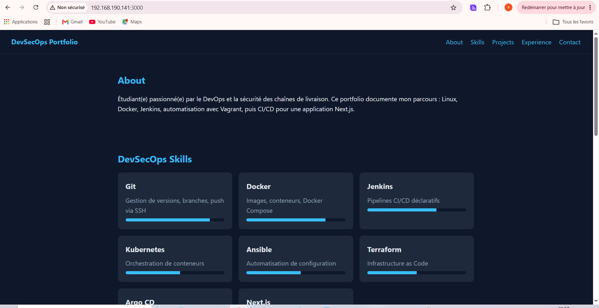

### 19. Composants réutilisables

```text
devsecops-portfolio-next/
├── app/
│   ├── layout.js              # Header + Footer communs
│   ├── page.js                # Accueil : About, Skills, Projects, Experience, Contact
│   ├── globals.css
│   └── projects/
│       ├── page.js            # /projects
│       └── [slug]/page.js     # /projects/project-name
├── components/
│   ├── Header.js
│   ├── About.js
│   ├── Skills.js
│   ├── Projects.js
│   ├── Experience.js
│   ├── Contact.js
│   └── Footer.js
├── data/
│   ├── projects.js
│   └── skills.js
├── Jenkinsfile
└── next.config.mjs
```

### 20. Données séparées des composants

Les informations sont stockées dans `data/` et importées par les composants, qui génèrent l'affichage avec `.map()`.

`data/projects.js` :

```js
export const projects = [
  {
    slug: "portfolio-docker",
    name: "Portfolio dockerisé",
    summary: "Portfolio servi par Nginx dans un conteneur.",
    description: "Image Docker cv-docker basée sur Nginx, lancée avec docker run puis Docker Compose.",
    tech: ["Docker", "Nginx", "Docker Compose"],
  },
  // ...
];

export function getProject(slug) {
  return projects.find((p) => p.slug === slug);
}
```

`data/skills.js` :

```js
export const skills = [
  { name: "Docker", level: 80, description: "Images, conteneurs, Docker Compose" },
  { name: "Jenkins", level: 70, description: "Pipelines CI/CD déclaratifs" },
  // Git, Kubernetes, Ansible, Terraform, Argo CD, Next.js...
];
```

### 21. Pages dédiées aux projets

| Route | Fichier | Rôle |
|---|---|---|
| `/projects` | `app/projects/page.js` | Liste de tous les projets |
| `/projects/project-name` | `app/projects/[slug]/page.js` | Détail d'un projet (route dynamique) |

Exemples : `http://192.168.190.141:3000/projects` et `http://192.168.190.141:3000/projects/portfolio-nextjs`.

<!-- À AJOUTER : captures des deux pages -->
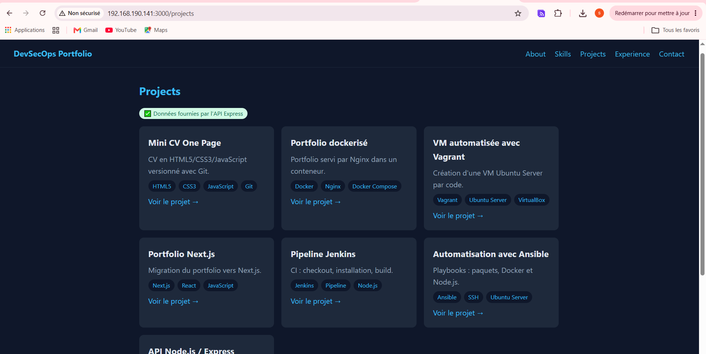
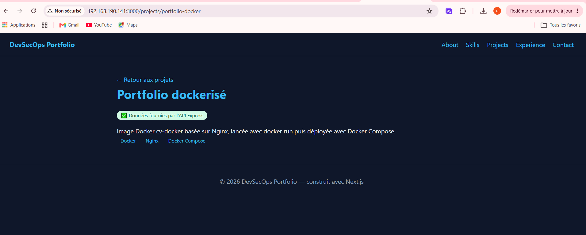

---

## VI. Premier pipeline Jenkins

### Préparation de Jenkins

Pour que le pipeline puisse utiliser un agent Docker :

```bash
sudo usermod -aG docker jenkins
sudo systemctl restart jenkins
```

Jenkins est accessible depuis la machine physique sur `http://192.168.190.141:8080`.

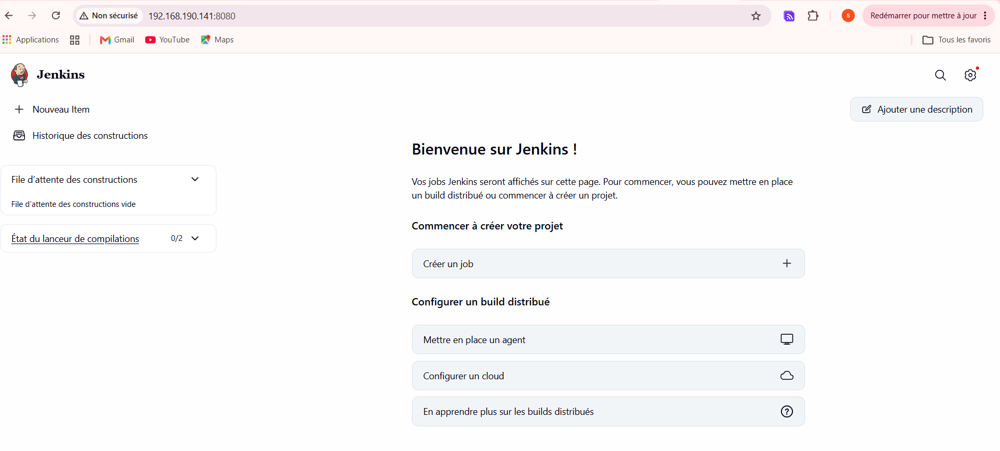

Plugins installés (Manage Jenkins → Plugins) : **Docker Pipeline**, **Docker Commons**, **Git server**, **SSH server**.

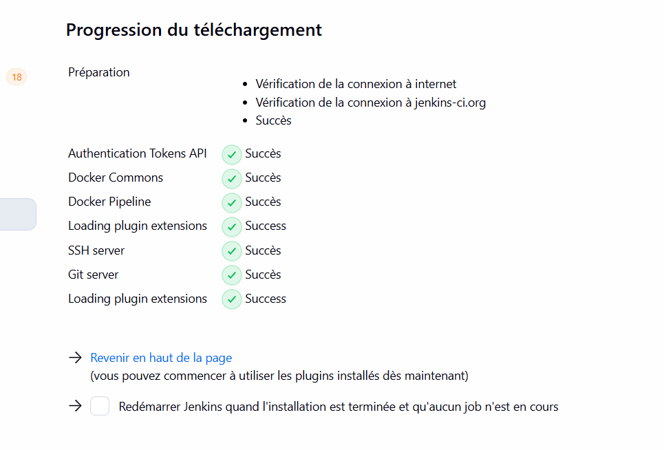

### 22. Pipeline : récupération du dépôt GitHub

Création du job : **Nouveau Item** → `devsecops-portfolio-pipeline` → type **Pipeline**.

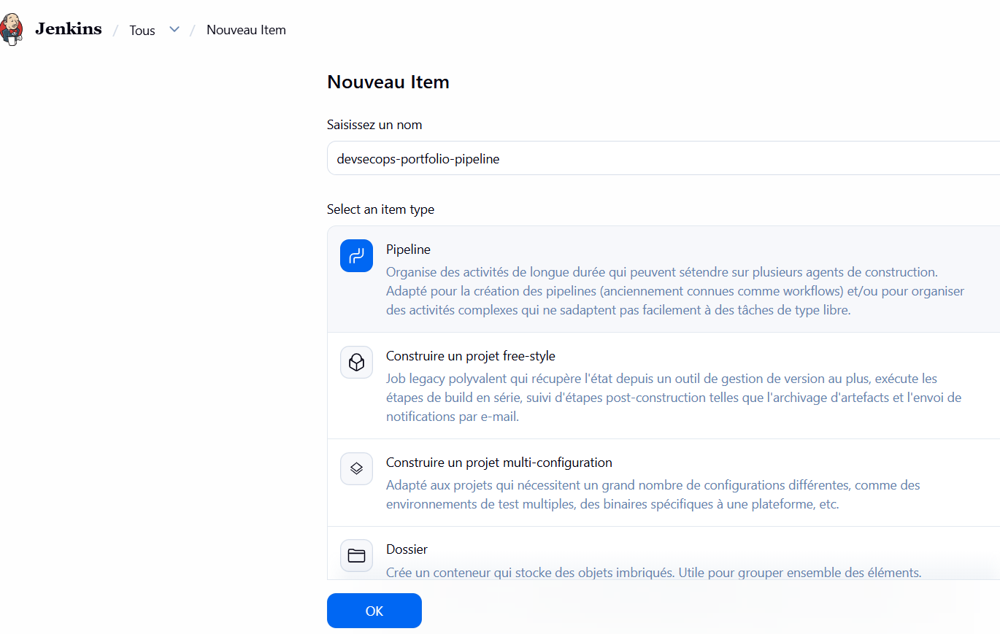

Configuration du job : *Pipeline script from SCM* → Git → URL du dépôt GitHub → branche `*/main` → Script Path `Jenkinsfile`.

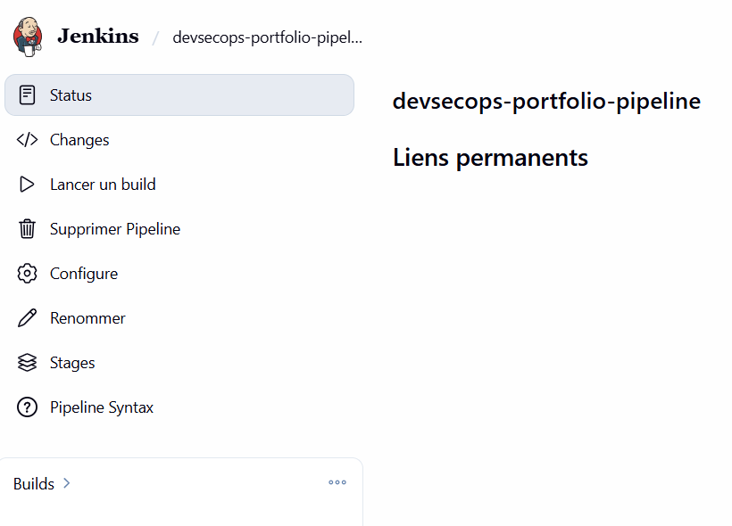

Lancement du build n°1 :

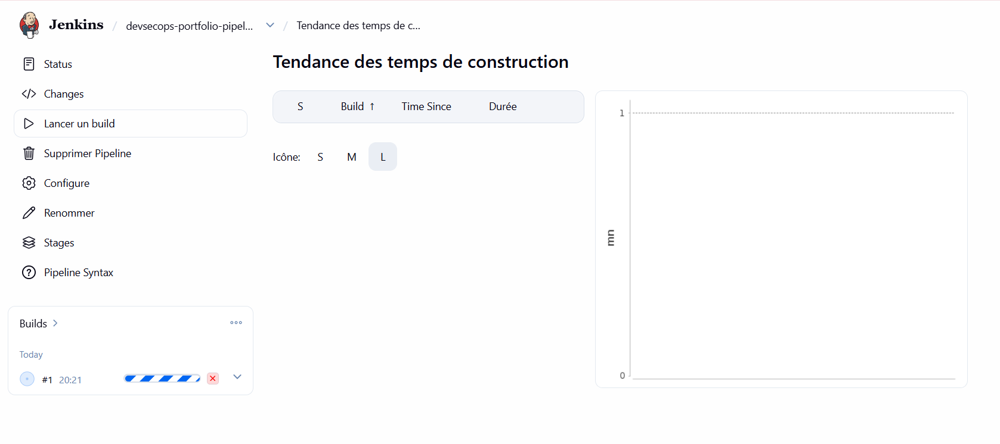

Résultat : build n°1 réussi (coche verte).

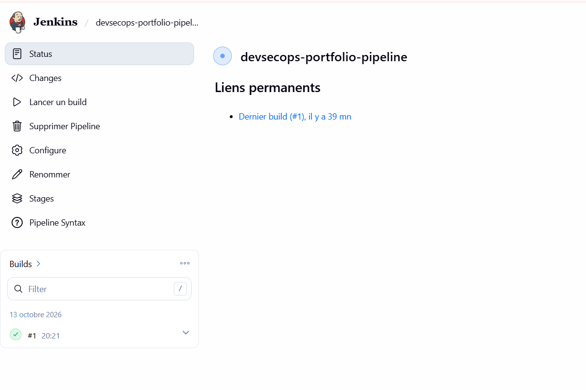

**Jenkinsfile** :

```groovy
pipeline {
    agent {
        docker {
            image 'node:22-alpine'
            args '-u root:root'
        }
    }

    environment {
        CI = 'true'
        NEXT_TELEMETRY_DISABLED = '1'
    }

    stages {
        stage('Checkout') {
            steps {
                git branch: 'main',
                    url: 'https://github.com/soulaymahableni/devsecops-portfolio-next.git'
            }
        }

        stage('Install dependencies') {
            steps {
                sh 'node --version && npm --version'
                sh 'npm ci || npm install'
            }
        }

        stage('Build') {
            steps {
                sh 'npm run build'
            }
        }
    }

    post {
        success { echo 'Build Next.js réussi.' }
        failure { echo 'Le pipeline a échoué, consultez les logs.' }
    }
}
```

### 23. Installation des dépendances

Stage `Install dependencies` : `npm ci` installe les versions exactes du `package-lock.json` (reproductible) ; `npm install` sert de repli si le fichier de verrouillage est absent.

<!-- À AJOUTER : Console Output du stage -->
### 24. Build automatique

Stage `Build` : `npm run build` compile l'application Next.js (`Compiled successfully` dans les logs).

<!-- À AJOUTER : Console Output du stage -->
---

## Publication sur GitHub (SSH)

```bash
git branch -M main
git add .
git commit -m "Portfolio Next.js avec Jenkinsfile"
git remote add origin git@github.com:soulaymahableni/devsecops-portfolio-next.git
git push -u origin main
```

Dépôt : https://github.com/soulaymahableni/devsecops-portfolio-next

---

## VII. Automatisation avec Ansible

**Architecture** :

| VM | IP | Rôle |
|---|---|---|
| `admin-ansible` | `192.168.190.155` | VM d'administration, Ansible installé |
| `automatisation` | `192.168.190.141` | Serveur Ubuntu géré par Ansible (Docker, Node.js, portfolio) |

Ansible est **sans agent** : il se connecte en SSH au serveur et exécute les tâches à distance.

### 25. Installation d'Ansible

Sur la VM `admin-ansible` :

```bash
sudo apt update
sudo apt install -y ansible
ansible --version
```

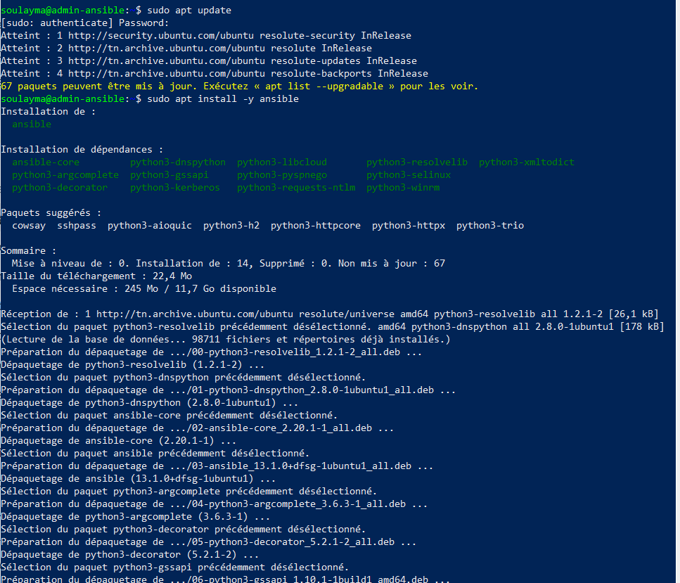

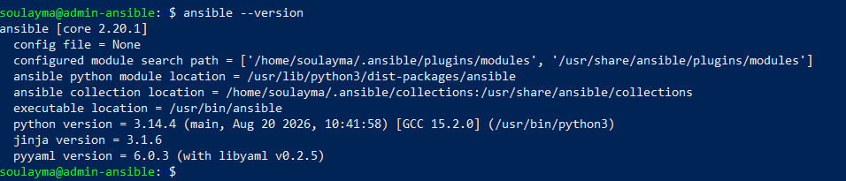

Connexion SSH sans mot de passe vers le serveur (clé ed25519) :

```bash
ssh-keygen -t ed25519
ssh-copy-id automatisation@192.168.190.141
ssh automatisation@192.168.190.141   # connexion sans mot de passe
```

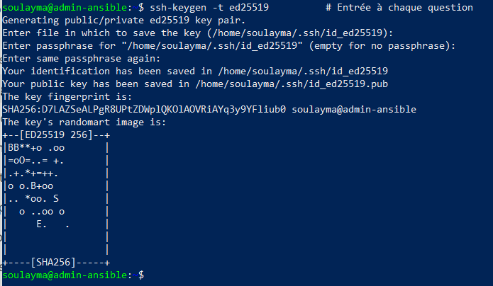

### 26. Inventory et test de communication

Création du dossier de travail :

```bash
mkdir -p ~/devsecops-portfolio/ansible && cd ~/devsecops-portfolio/ansible
```

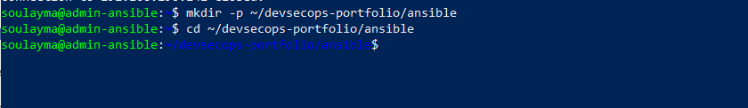

`ansible/inventory.ini` :

```ini
[ubuntu_servers]
server1 ansible_host=192.168.190.141 ansible_user=automatisation

[docker_hosts]
server1

[all:vars]
ansible_python_interpreter=/usr/bin/python3
ansible_become_exe=/usr/bin/sudo.ws
```

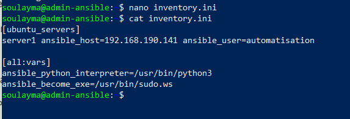

`ansible/ansible.cfg` (évite de répéter `-i inventory.ini`) :

```ini
[defaults]
inventory = inventory.ini
host_key_checking = False
```

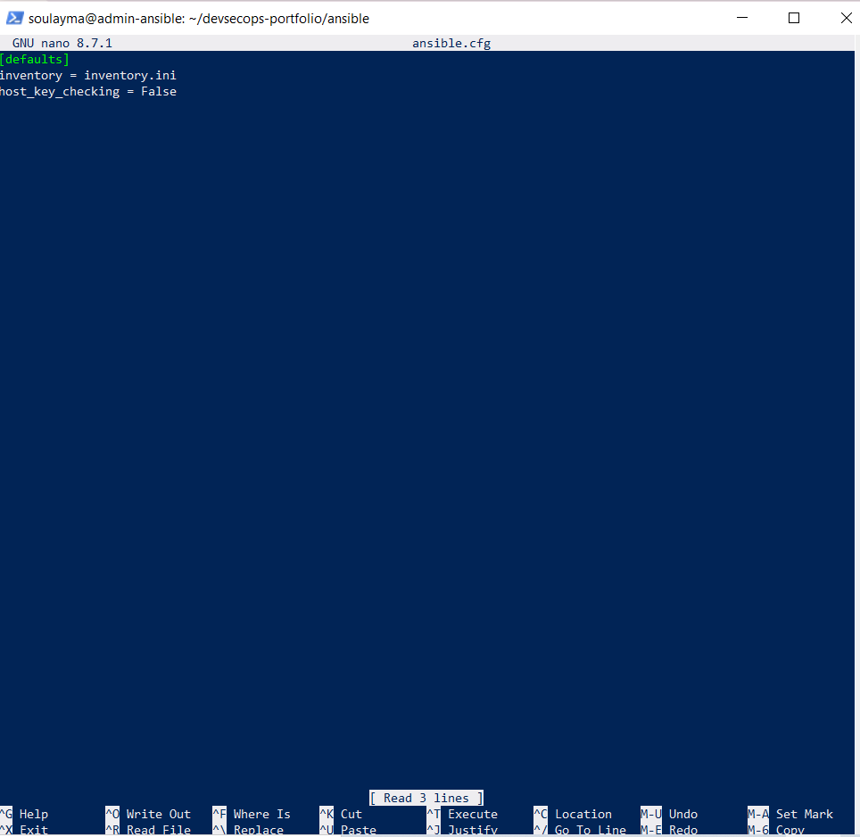

Commande :

```bash
ansible all -m ping
```

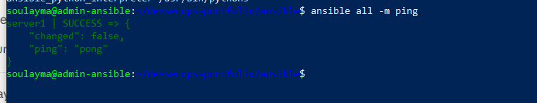

> **Problème rencontré** : Ubuntu 26.04 utilise `sudo-rs` par défaut, dont l'invite de mot de passe n'est pas reconnue par Ansible (`Timeout waiting for privilege escalation prompt`). Solution : utiliser le sudo classique, toujours présent sous le nom `/usr/bin/sudo.ws`, via `ansible_become_exe`.

### 27. Playbook : installation de paquets

`ansible/install_packages.yml` :

```yaml
---
- name: Installer des paquets de base
  hosts: ubuntu_servers
  become: true
  tasks:
    - name: Installer curl, git et tree
      ansible.builtin.apt:
        name:
          - curl
          - git
          - tree
        state: present
        update_cache: true
```

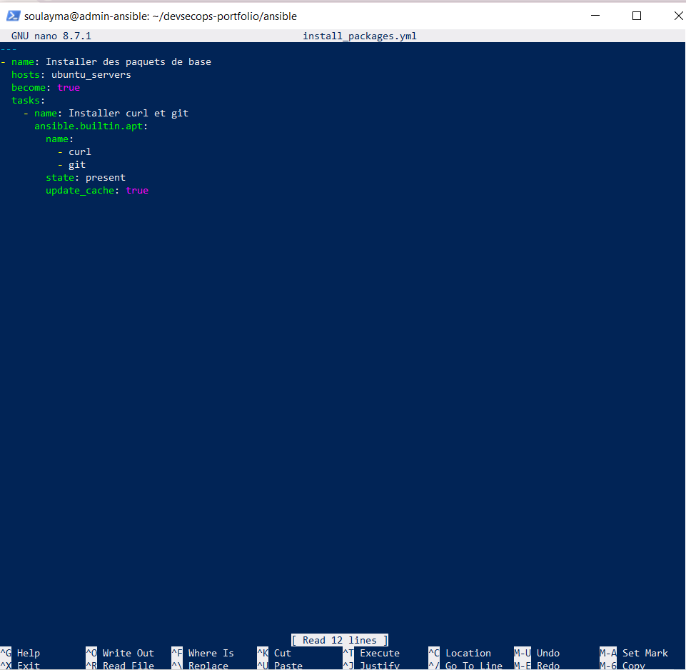

```bash
ansible-playbook install_packages.yml -K
```

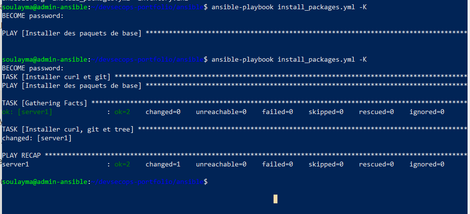

Une exécution sur des paquets déjà présents donne `changed=0` : Ansible est **idempotent**, il ne refait pas ce qui est déjà en place.

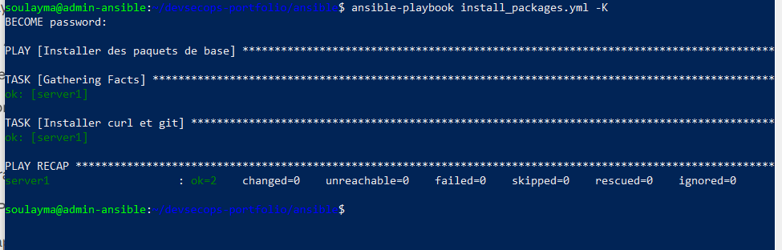

### 28. Playbook : installation de Docker

`ansible/install_docker.yml` :

```yaml
---
- name: Installer Docker sur Ubuntu
  hosts: docker_hosts
  become: true

  tasks:
    - name: Installer Docker, Docker Compose et Buildx
      ansible.builtin.apt:
        name:
          - docker.io
          - docker-compose-v2
          - docker-buildx
        state: present
        update_cache: true

    - name: Démarrer Docker et l'activer au démarrage
      ansible.builtin.service:
        name: docker
        state: started
        enabled: true

    - name: Ajouter l'utilisateur au groupe docker
      ansible.builtin.user:
        name: "{{ ansible_user }}"
        groups: docker
        append: true

    - name: Récupérer la version de Docker
      ansible.builtin.command: docker --version
      register: docker_version
      changed_when: false

    - name: Récupérer la version de Docker Compose
      ansible.builtin.command: docker compose version
      register: compose_version
      changed_when: false

    - name: Afficher les versions
      ansible.builtin.debug:
        msg:
          - "{{ docker_version.stdout }}"
          - "{{ compose_version.stdout }}"
```

```bash
ansible-playbook install_docker.yml -K
```

Résultat de `docker --version` :

```
Docker version 29.1.3, build 29.1.3-0ubuntu4.1
Docker Compose version 2.40.3+ds1-0ubuntu1
```

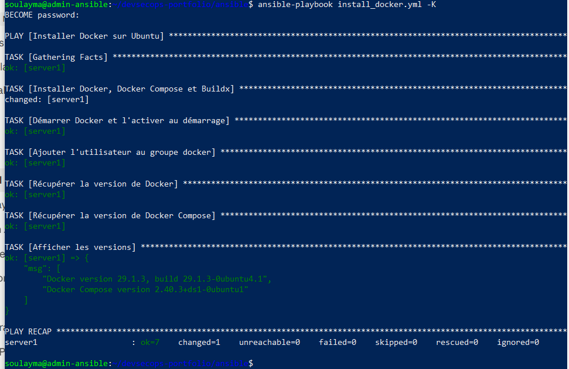

Les paquets Docker officiels d'Ubuntu (`docker.io`) sont utilisés pour éviter un conflit avec le `containerd` déjà présent. Le playbook est réutilisable sur toute nouvelle VM : il suffit de l'ajouter au groupe `docker_hosts`.

**Bonus** : `ansible/install_node.yml` installe Node.js 22 (npm est inclus dans le paquet `nodejs` d'Ubuntu 26.04, installer `npm` séparément provoque un conflit).

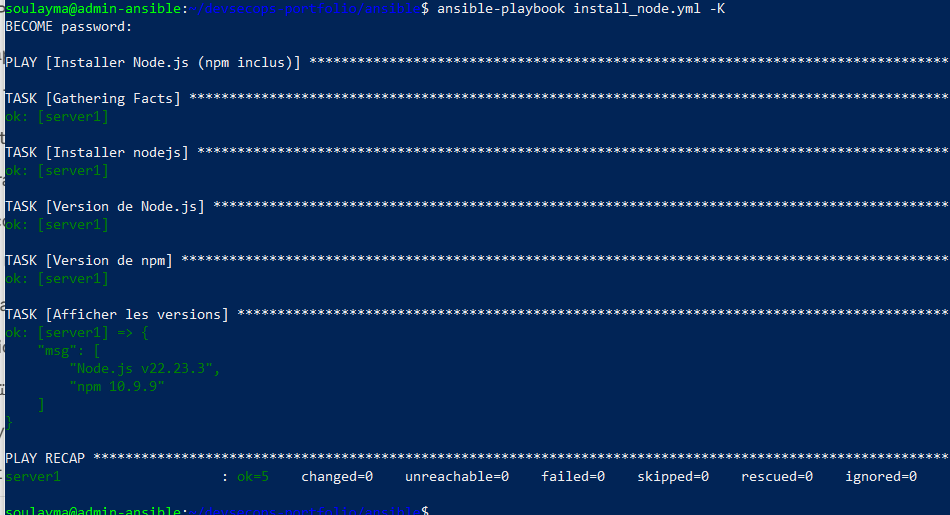

---

## VIII. API Node.js / Express

### 29. Structure de l'API

L'API est indépendante du frontend et se lance seule :

```bash
cd api
npm install
npm run dev
```

```
api/
├── Dockerfile
├── .dockerignore
├── .env.example
├── package.json
├── package-lock.json
└── src/
    ├── server.js          # serveur Express et routes
    └── data/
        └── portfolio.js   # profil, projets, compétences
```

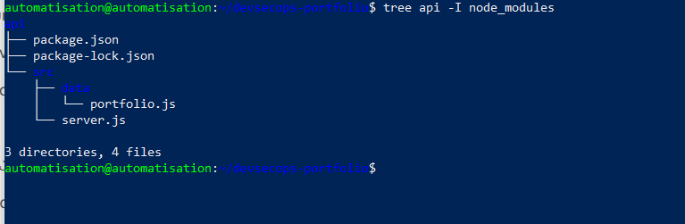

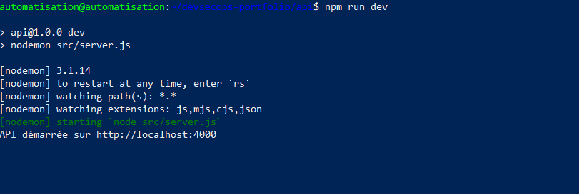

### 30. GET /api/health

```bash
curl http://192.168.190.141:4000/api/health
```

```json
{ "status": "ok", "message": "API opérationnelle", "uptime": 512.55, "timestamp": "2026-10-20T11:52:39.385Z" }
```

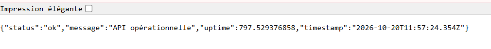

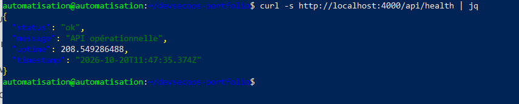

### 31. GET /api/profile

Retourne le nom, le titre, la présentation et les contacts du portfolio.

### 32. GET /api/projects

Retourne la liste des projets (`slug`, `name`, `summary`, `description`, `tech`). Une route `GET /api/projects/:slug` retourne aussi le détail d'un projet.

### 33. GET /api/skills

> **Problème rencontré** : l'API répondait en local mais pas depuis Windows (`ERR_CONNECTION_TIMED_OUT`). Le pare-feu UFW bloquait les ports. Solution : `sudo ufw allow 4000/tcp` et `sudo ufw allow 3000/tcp`.
>
> 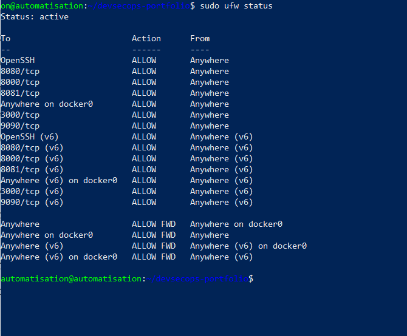

### 34. Projets récupérés depuis l'API

Les composants `About`, `Projects` et `Skills` ne lisent plus directement `data/` : ils appellent l'API côté serveur via `lib/api.js`.

```js
const API_URL = process.env.API_URL || "http://127.0.0.1:4000";

async function fetchFromApi(path, fallback) {
  try {
    const res = await fetch(`${API_URL}${path}`, { cache: "no-store" });
    if (!res.ok) throw new Error(`HTTP ${res.status}`);
    return { data: await res.json(), source: "api" };
  } catch (err) {
    return { data: fallback, source: "local" };   // repli sur data/
  }
}
```

- Un badge **« Données fournies par l'API Express »** indique la source des données.
- Si l'API est arrêtée, les données locales de `data/` sont affichées (badge rouge) : le site reste disponible.
- Les pages utilisent `export const dynamic = "force-dynamic"` : l'API est appelée à chaque requête et non figée au moment du build. Le build (et donc le pipeline Jenkins) fonctionne même sans API.
- Les projets « Automatisation avec Ansible » et « API Node.js / Express » n'existent que dans l'API : leur présence prouve que les données viennent bien de l'API.

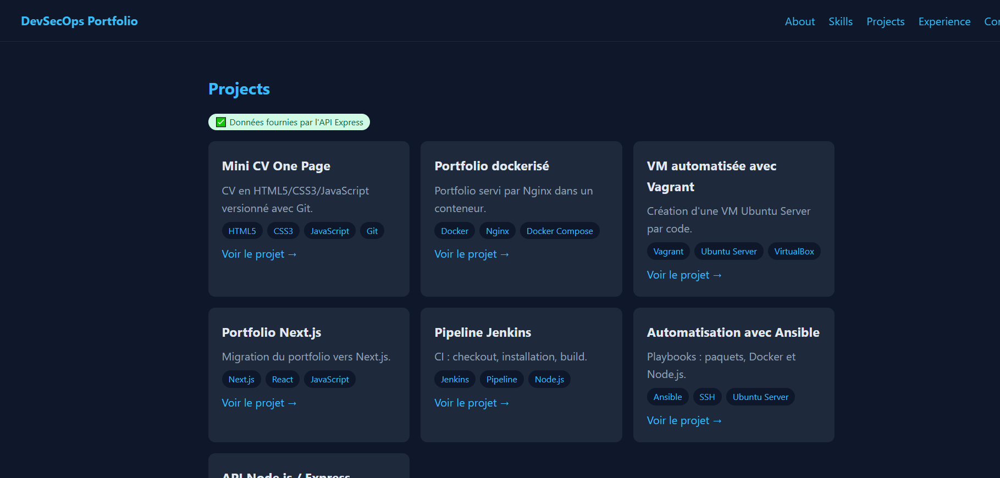

### 35. Compétences récupérées depuis l'API

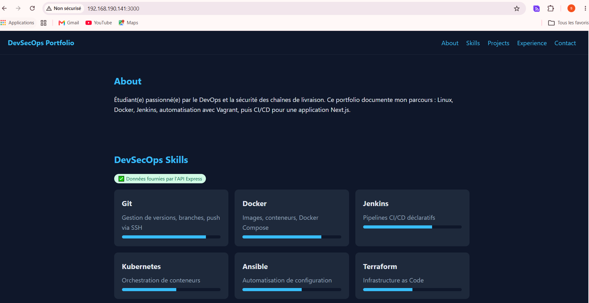

---

## IX. Variables d'environnement et configuration

### 36. API_URL

`.env.local` (non versionné) :

```
API_URL=http://127.0.0.1:4000
```

**Pourquoi ne pas coder l'URL en dur ?** L'adresse de l'API change selon l'environnement : `127.0.0.1:4000` en local, `http://api:4000` dans Docker Compose, un nom de domaine en production. Coder l'URL en dur obligerait à modifier le code et reconstruire l'image à chaque changement. Avec une variable d'environnement, la même image fonctionne partout et la configuration reste séparée du code. L'appel se faisant côté serveur, `API_URL` n'est jamais exposée au navigateur.

> `127.0.0.1` est utilisé plutôt que `localhost`, que Node.js 22 peut résoudre en IPv6 (`::1`).

### 37. .env.example

`.env.example` (versionné, sans secret) :

```
# URL de l'API Express, appelée côté serveur par Next.js
# Local          : http://127.0.0.1:4000
# Docker Compose : http://api:4000
API_URL=http://127.0.0.1:4000
```

`api/.env.example` :

```
PORT=4000
CORS_ORIGIN=http://localhost:3000
```

Le `.gitignore` contient `.env*` puis `!.env.example` : les vrais fichiers `.env` ne sont jamais poussés sur GitHub.

---

## X. Dockerisation frontend + API

### 38. Dockerfile du frontend

`next.config.mjs` contient `output: "standalone"`.

```dockerfile
# 1) Installation des dépendances
FROM node:22-alpine AS deps
WORKDIR /app
COPY package*.json ./
RUN npm ci --fetch-retries=5 --fetch-retry-mintimeout=20000 --fetch-retry-maxtimeout=120000 --fetch-timeout=600000

# 2) Build de l'application
FROM node:22-alpine AS builder
WORKDIR /app
COPY --from=deps /app/node_modules ./node_modules
COPY . .
ENV NEXT_TELEMETRY_DISABLED=1
RUN npm run build

# 3) Image finale minimale (mode standalone)
FROM node:22-alpine AS runner
WORKDIR /app
ENV NODE_ENV=production \
    NEXT_TELEMETRY_DISABLED=1 \
    PORT=3000 \
    HOSTNAME=0.0.0.0

RUN addgroup -S nextjs && adduser -S nextjs -G nextjs

COPY --from=builder /app/public ./public
COPY --from=builder --chown=nextjs:nextjs /app/.next/standalone ./
COPY --from=builder --chown=nextjs:nextjs /app/.next/static ./.next/static

USER nextjs
EXPOSE 3000
CMD ["node", "server.js"]
```

- **Build multi-étapes** : l'image finale contient seulement l'application compilée, sans code source ni dépendances de développement (image plus légère, surface d'attaque réduite).
- **Utilisateur non root** `nextjs` (bonne pratique DevSecOps).
- `.dockerignore` exclut `node_modules`, `.git`, `.env*`, `api/`, `ansible/` et `docs/`.
- Les options `--fetch-retries` rendent `npm ci` tolérant à une connexion lente.

### 39. Dockerfile de l'API

`api/Dockerfile` :

```dockerfile
FROM node:22-alpine
WORKDIR /app
ENV NODE_ENV=production

COPY package*.json ./
RUN npm ci --omit=dev

COPY src ./src

USER node
EXPOSE 4000
CMD ["node", "src/server.js"]
```

- `--omit=dev` : seules les dépendances de production sont installées (pas de nodemon).
- `package*.json` est copié avant le code pour profiter du cache Docker.
- Exécution avec l'utilisateur non root `node`.

### 40. Construction des images

```bash
docker build -t devsecops-api ./api
docker build --network=host -t devsecops-portfolio .
docker images | grep devsecops
```

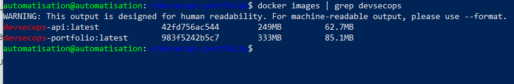

> **Problème rencontré** : `npm ci` restait bloqué (`ETIMEDOUT`) pendant le build, à cause du réseau de la VM (k3s y est aussi installé). Solution : build avec le réseau de l'hôte (`--network=host`, ou `network: host` dans le Compose).

### 41. Docker Compose

`docker-compose.yml` :

```yaml
services:
  api:
    build:
      context: ./api
      network: host
    image: devsecops-api
    container_name: devsecops-api
    environment:
      - PORT=4000
      - CORS_ORIGIN=http://localhost:3000
    ports:
      - "4000:4000"
    healthcheck:
      test: ["CMD", "wget", "-qO-", "http://127.0.0.1:4000/api/health"]
      interval: 10s
      timeout: 3s
      retries: 5
    networks:
      - portfolio-net
    restart: unless-stopped

  frontend:
    build:
      context: .
      network: host
    image: devsecops-portfolio
    container_name: devsecops-portfolio
    environment:
      - API_URL=http://api:4000
    ports:
      - "3000:3000"
    depends_on:
      api:
        condition: service_healthy
    networks:
      - portfolio-net
    restart: unless-stopped

networks:
  portfolio-net:
    driver: bridge
```

```bash
docker compose up -d
docker compose ps
```

```
NAME                  IMAGE                 SERVICE    STATUS                    PORTS
devsecops-api         devsecops-api         api        Up (healthy)              0.0.0.0:4000->4000/tcp
devsecops-portfolio   devsecops-portfolio   frontend   Up                        0.0.0.0:3000->3000/tcp
```

Le `healthcheck` vérifie `/api/health` ; grâce à `depends_on: condition: service_healthy`, le frontend ne démarre qu'une fois l'API prête.

### 42. Communication frontend ↔ API

Dans Compose, `API_URL=http://api:4000` : **`api` est le nom du service**, résolu par le DNS interne de Docker sur le réseau `portfolio-net`. Le frontend joint l'API sans connaître son adresse IP.

```bash
docker compose exec frontend wget -qO- http://api:4000/api/health
```

```json
{"status":"ok","message":"API opérationnelle","uptime":168.75,"timestamp":"2026-10-20T14:14:33.164Z"}
```

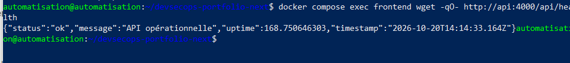

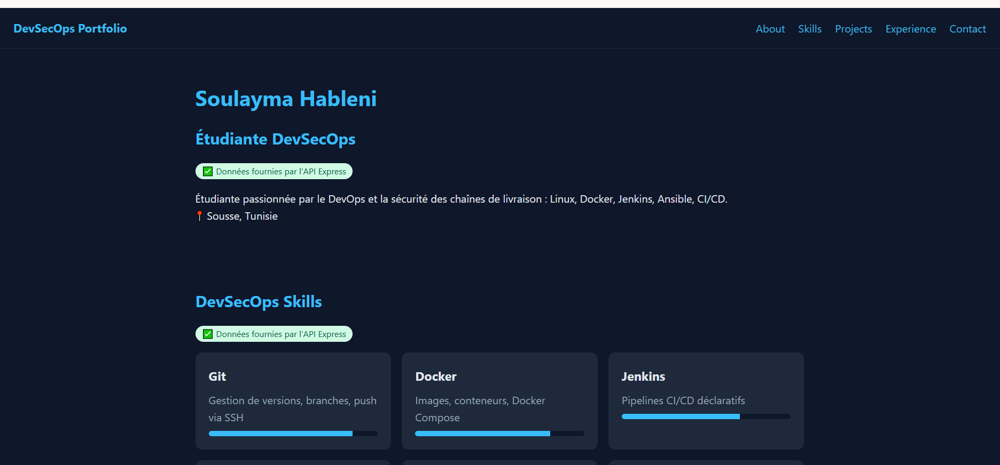

Démonstration du repli : `docker compose stop api` → le portfolio affiche les données locales ; `docker compose start api` → les données de l'API reviennent.

---

# Activité 4 : Vagrant/Ansible, sécurisation de l'API, PostgreSQL, tests et pipeline DevSecOps

## Avancement

| Partie | Questions | État |
|---|---|---|
| 11. Vagrant + Ansible | 43-45 | ✅ fait |
| 12. API sécurisée | 46-52 | ✅ fait |
| 13. PostgreSQL / Prisma | 53-56 | ✅ fait |
| 14. Tests | 57-60 | ✅ fait |
| 15. Jenkins tests + images | 61-63 | ✅ fait |
| 16. Pipeline DevSecOps | 64-69 | ✅ fait (Dependency-Check non bloquant, voir Q67) |

---

## 11. Vagrant + Ansible

### Q43 : playbook de déploiement du Portfolio

```bash
cd ~/portfolio-iac
vagrant provision        # lance : ansible-playbook ansible/site.yml
```

Le playbook (`vagrant/ansible/site.yml`) utilise deux rôles : `docker_install` (Docker + plugin Compose) et `portfolio_deploy` (clone du dépôt, `docker compose up -d --build`, attente du port 3000, affichage de `docker ps`).

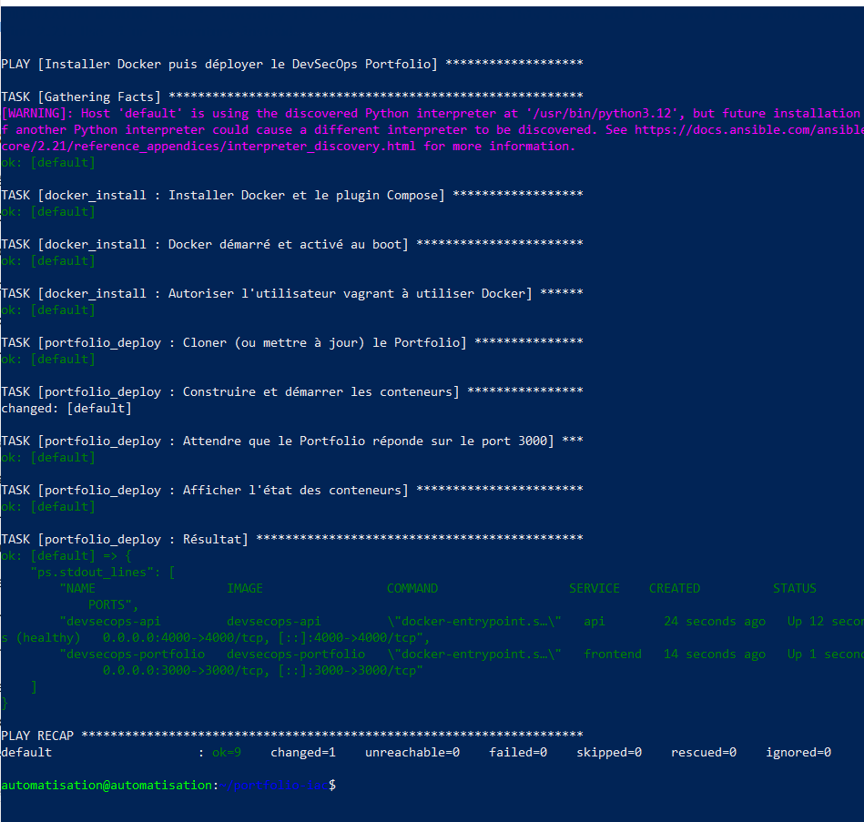
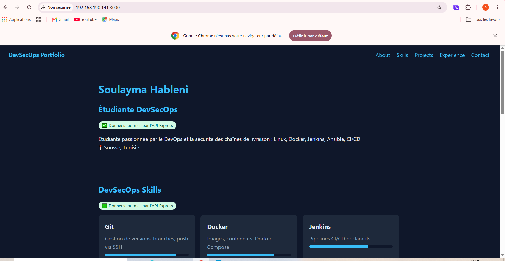

### Q44 : lancement automatique d'Ansible par Vagrant

`vagrant up` -> création de la VM -> provisioner `ansible_local` -> installation de Docker -> déploiement du Portfolio.

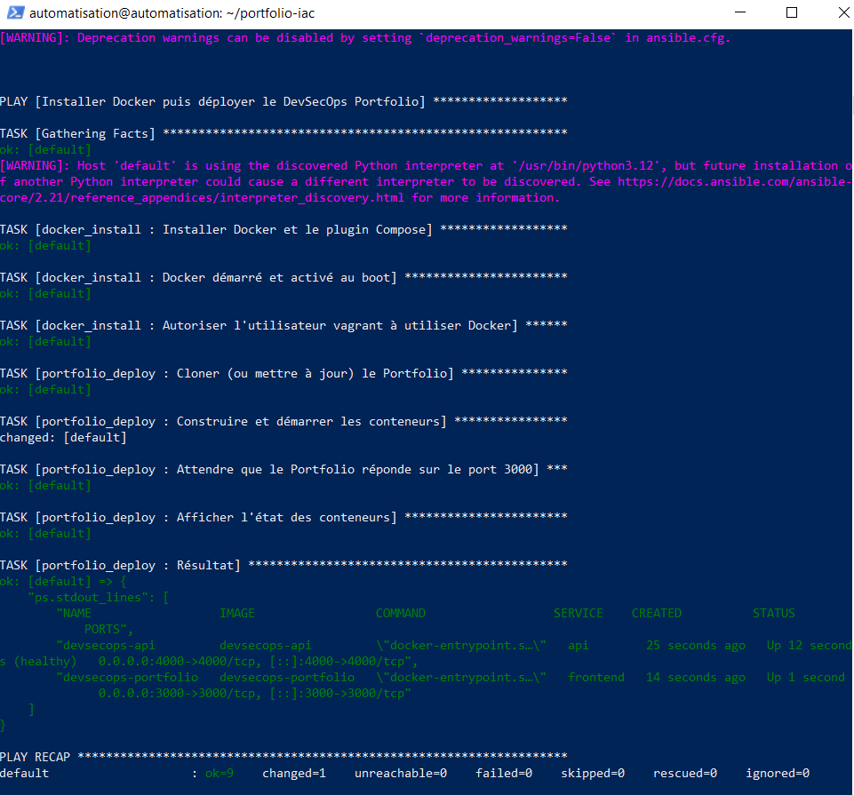

### Q45 : destroy puis up

```bash
vagrant destroy -f
vagrant up
```
Voir les captures dans la section « Activité 4 : compléments » plus bas.

---

## 12. Évolution et sécurisation de l'API

### Q46 : route `POST /api/contact`

```bash
curl -i -X POST http://localhost:4000/api/contact \
  -H "Content-Type: application/json" \
  -d '{"name":"Soulayma","email":"test@example.com","message":"Bonjour, ceci est un test"}'
```
Réponse : `HTTP/1.1 201 Created` — `{"message":"Message reçu","id":1}`

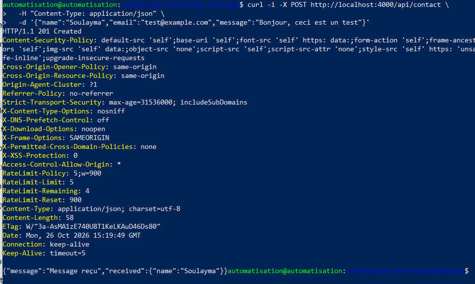

### Q47 : formulaire Next.js connecté à l'API

Le formulaire (`components/Contact.jsx`) appelle `app/api/contact/route.js`, qui relaie vers l'API Express (`API_URL`).

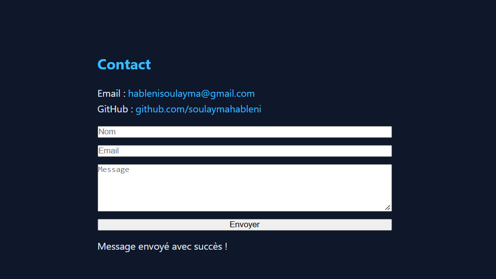

### Q48 : validation stricte avec Zod

Schéma `.strict()` : champs inconnus, email invalide ou message trop court -> `400`.

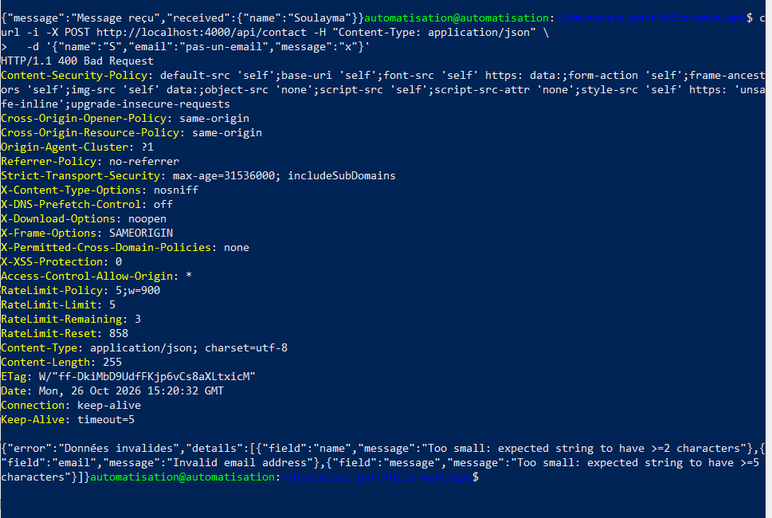

### Q49 : gestion centralisée des erreurs

Un seul middleware d'erreur renvoie un JSON propre, sans stack trace (ex. JSON malformé -> 400).

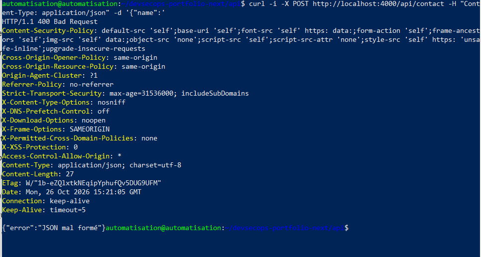

### Q50 : headers de sécurité Helmet

```bash
curl -I http://localhost:4000/api/health
```
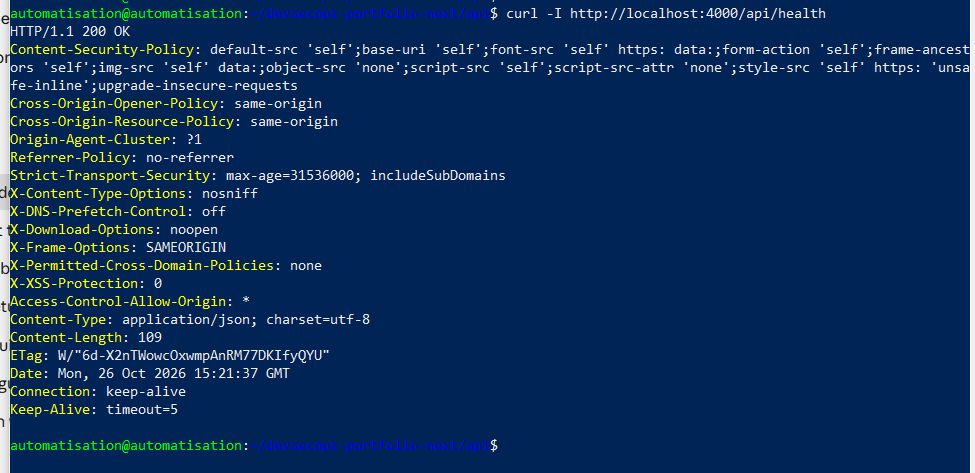

### Q51 : rate limiting (5 requêtes / 15 min sur `POST /api/contact`)

Les 5 premières requêtes passent (201), la 6e est refusée (429).

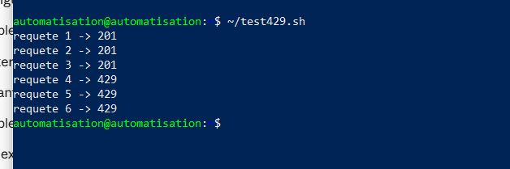
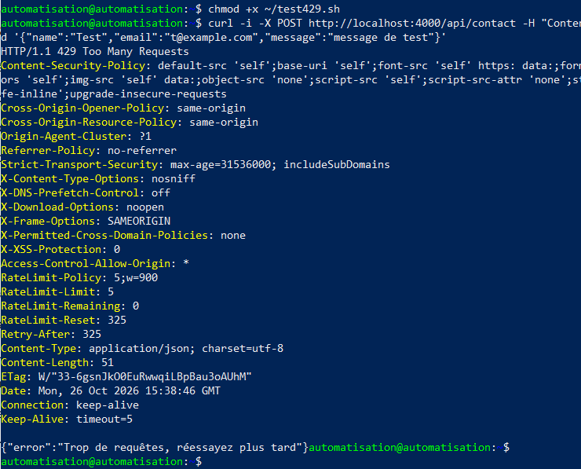

### Q52 : OWASP API Security Top 10

| Risque OWASP | Concerne notre API ? | Mesure en place / prévue |
|---|---|---|
| API1 Broken Object Level Authorization | Faible (pas de comptes utilisateurs) | Aucune ressource privée exposée ; à prévoir si authentification ajoutée |
| API2 Broken Authentication | Non (API publique en lecture) | Prévu : authentification pour toute future route d'administration |
| API3 Broken Object Property Level Authorization | Oui | Zod `.strict()` : seuls `name`, `email`, `message` sont acceptés |
| API4 Unrestricted Resource Consumption | Oui | Rate limiting 5/15 min sur `/api/contact` ; corps JSON limité à 10 kb |
| API5 Broken Function Level Authorization | Faible | Seules des routes GET publiques + un POST de contact |
| API6 Unrestricted Access to Sensitive Business Flows | Oui (spam du formulaire) | Rate limiting ; prévu : captcha |
| API7 Server Side Request Forgery | Non | L'API n'appelle aucune URL fournie par l'utilisateur |
| API8 Security Misconfiguration | Oui | Helmet, `x-powered-by` désactivé, CORS restreint (`CORS_ORIGIN`), erreurs sans stack trace, secrets en variables d'environnement |
| API9 Improper Inventory Management | Faible | Routes documentées dans ce README |
| API10 Unsafe Consumption of APIs | Non | Aucune API tierce consommée |

---

## 13. PostgreSQL et Prisma

### Q53 : service PostgreSQL dans Docker Compose

Service `db` : image `postgres:16-alpine`, healthcheck `pg_isready`, volume `pgdata`.

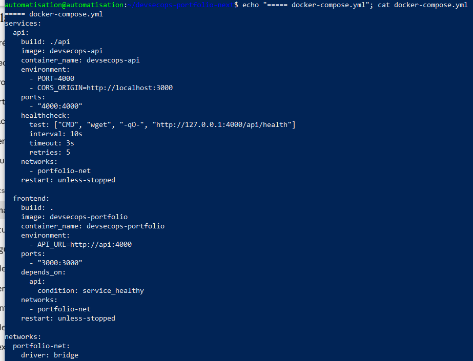
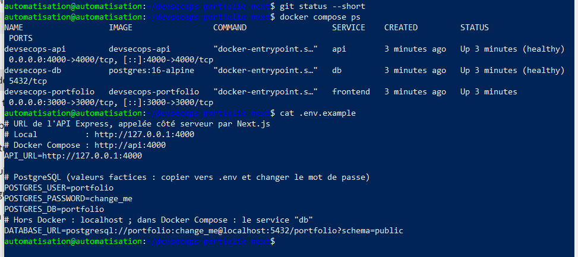

### Q54 : enregistrement des messages en base

```bash
docker compose exec db psql -U portfolio -d portfolio -c 'SELECT * FROM "Message";'
```
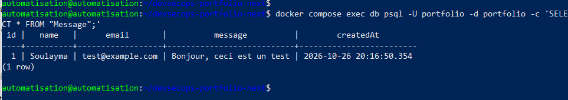
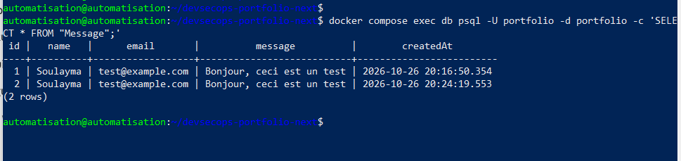

### Q55 : migrations Prisma

```bash
cd api
npx prisma migrate dev --name init     # développement
npx prisma migrate deploy              # production (lancé au démarrage du conteneur API)
```
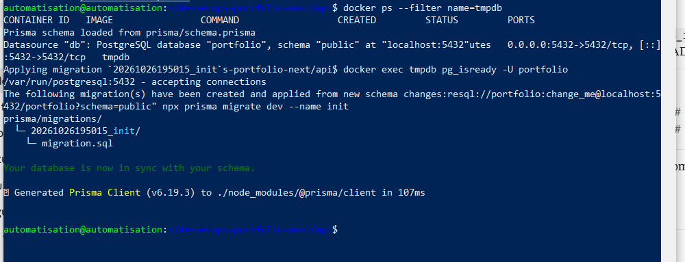

### Q56 : variables dans `.env.example`

`POSTGRES_USER`, `POSTGRES_PASSWORD`, `POSTGRES_DB`, `DATABASE_URL` (valeurs factices uniquement ; le vrai `.env` n'est pas versionné).

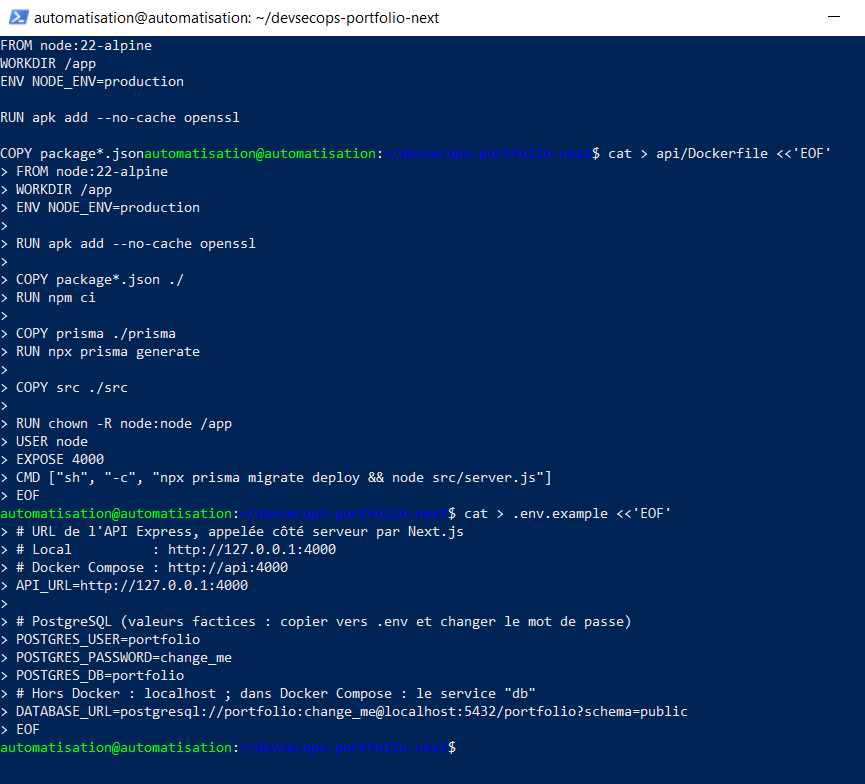

---

## 14. Tests applicatifs

### Q57 : test frontend (Vitest + Testing Library)

```bash
npm test
```
3 tests passés (`tests/Contact.test.jsx`).

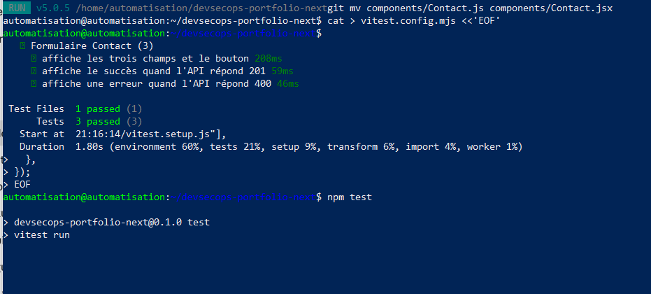

### Q58-59 : tests API (Jest + Supertest) : route, entrées invalides, injections, requêtes malformées

```bash
cd api && npm test
```
17 tests passés (`api.test.js`, `security.test.js`).

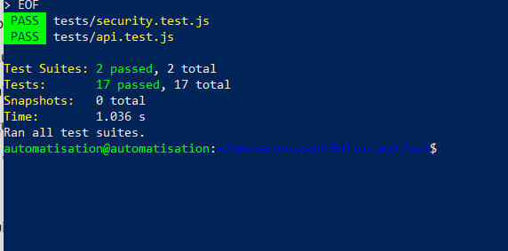

### Q60 : test d'intégration frontend -> API -> PostgreSQL

```bash
npm run test:integration     # bash tests/integration.sh
```
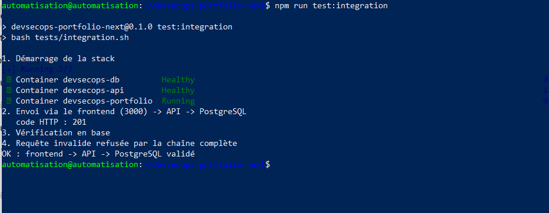

---

## 15-16. Jenkins et pipeline DevSecOps

Le `Jenkinsfile` enchaîne : Checkout + Git SHA, Tests API, Tests Frontend (conteneur `node:22-alpine`), Gitleaks, Semgrep, npm audit, Dependency-Check, build des images `devsecops-portfolio:<SHA>` et `devsecops-api:<SHA>`, Trivy (échec si CRITICAL).


---

# Activité 4 : compléments (Vagrant, Jenkins, pipeline DevSecOps)

## Q44 et Q45 : Vagrant, Ansible et redéploiement automatique

`vagrant up` crée la VM, lance Ansible (`ansible_local`), installe Docker, puis déploie le Portfolio avec Docker Compose. Test de la Q45 : la VM est détruite puis recréée, et le Portfolio est redéployé sans intervention.

```bash
cd ~/portfolio-iac
vagrant destroy -f
vagrant up
```

Résultat : `PLAY RECAP` avec `ok=9 changed=4 failed=0`.

Portfolio accessible après le redéploiement :

## Q61 à Q69 : pipeline Jenkins

Le `Jenkinsfile` exécute : tests de l'API et du frontend, Gitleaks, Semgrep, npm audit, Dependency-Check (non bloquant), build des images `devsecops-portfolio` et `devsecops-api` taguées avec le Git SHA, puis Trivy.

| Question | Outil | Résultat |
|---|---|---|
| Q64 | Gitleaks | Aucun secret détecté |
| Q65 | Semgrep | 0 finding (un faux positif CSRF a été justifié avec `nosemgrep`, car l'API est stateless) |
| Q66 | npm audit | 0 vulnérabilité critique (Next.js mis à jour de 16.4.0 vers 16.4.3) |
| Q67 | Dependency-Check | Configuré et non bloquant : la base NVD exige une clé API, indisponible dans le lab. La détection est assurée par `npm audit` |
| Q68 | Trivy | Aucune vulnérabilité CRITICAL dans les deux images |

Exemple de dépendances vulnérables détectées (Q67) :

### Q69 : pipeline réussi et pipeline échoué

Le pipeline échoue dès qu'un secret ou une vulnérabilité critique est détecté. Sur la capture : le build **#10 est réussi** et le build **#9 a échoué** (Trivy). Le build #6 avait aussi échoué sur Semgrep (faux positif CSRF).

Le détail de chaque scanner est visible dans la console du build Jenkins (job `devsecops-portfolio-pipeline`).

---

# Activité 5 : GitHub Actions et sécurité GitHub (Q70–78)

## Q70 à Q73 : workflow CI

Le workflow `.github/workflows/ci.yml` se déclenche à chaque `push` sur `main` et à chaque Pull Request. Il contient six jobs :

| Job | Rôle | Outil |
|---|---|---|
| `tests-api` | Tests de l'API | Jest, Supertest |
| `tests-frontend` | Tests du frontend | Vitest |
| `secrets` | Détection de secrets | Gitleaks |
| `sast` | Analyse statique du code | Semgrep |
| `dependencies` | Contrôle des dépendances | `npm audit` (seuil critique) |
| `images` | Construction des deux images Docker puis scan | Docker, Trivy (CRITICAL, `--exit-code 1`) |

Le job `images` dépend des deux jobs de tests : si un test échoue, les images ne sont pas construites.


## Q74 : CodeQL et comparaison avec Semgrep

CodeQL est activé par le workflow `.github/workflows/codeql.yml` (push, Pull Request et analyse hebdomadaire). Il a levé une alerte **Permissive CORS configuration** (gravité moyenne) dans `api/src/app.js` : l'API autorisait toutes les origines (`*`). L'alerte a été corrigée en limitant l'origine par défaut (variable `CORS_ORIGIN`), puis fermée.

Avant la correction :


Après la correction :


| Critère | Semgrep | CodeQL |
|---|---|---|
| Alerte détectée | Absence de protection CSRF (`express-check-csurf-middleware-usage`) | Configuration CORS permissive |
| Pertinence | Faux positif : l'API est stateless, sans cookie ni session | Vraie alerte |
| Traitement | Exception `nosemgrep` avec justification écrite dans le code | Correction du code, alerte fermée |
| Où lire le résultat | Journal du job `sast` | Onglet Security, Code scanning |
| Rôle dans le pipeline | Bloque la CI (`--error`) | Analyse plus profonde du flux de données |

Les deux outils sont complémentaires : Semgrep est rapide et bloque la Pull Request, CodeQL détecte des problèmes que les règles simples de Semgrep ne voient pas.

## Q75 : Dependabot

Le fichier `.github/dependabot.yml` surveille chaque semaine les dépendances npm (`/` et `/api`), les images Docker (`/` et `/api`) et les actions GitHub. Les messages de commit suivent la convention (`chore(deps)`, `chore(docker)`, `ci`). Un **cooldown de 7 jours** a été ajouté pour ne pas proposer une version publiée depuis moins d'une semaine (une version malveillante est souvent retirée dans les premiers jours). Cette règle a été demandée par Semgrep (`dependabot-missing-cooldown`).


Exemple de Pull Request générée automatiquement :


## Q76 : permissions du GITHUB_TOKEN

Le workflow CI et le workflow Release déclarent `permissions: contents: read` (lecture seule) au niveau global. Les jobs qui ont besoin de plus reçoivent uniquement ce qui est nécessaire :

| Workflow | Job | Permissions supplémentaires | Raison |
|---|---|---|---|
| `codeql.yml` | `analyze` | `security-events: write` | Publier les résultats dans l'onglet Security |
| `release.yml` | `release` | `contents: write`, `issues: write`, `pull-requests: write` | Créer le tag et la release |

Principe du moindre privilège : si le token fuit ou si une action tierce est compromise, les dégâts sont limités.

## Q77 : actions épinglées par SHA

Les actions tierces sont référencées par le **SHA du commit**, avec la version en commentaire :

```yaml
- uses: actions/checkout@34e114876b0b11c390a56381ad16ebd13914f8d5 # v4.3.1
- uses: actions/setup-node@49933ea5288caeca8642d1e84afbd3f7d6820020 # v4.4.0
- uses: github/codeql-action/analyze@9b3254085494b55a0f7c4c2b3d2d52cc712ce370 # v4.39.1
```

**Pourquoi la chaîne CI/CD est une surface d'attaque.** Un tag comme `@v4` est modifiable : si le compte d'un mainteneur est compromis, l'attaquant peut déplacer le tag vers du code malveillant, qui s'exécuterait dans notre pipeline avec accès au code, aux secrets et au token. Un SHA est immuable. Plus largement, le pipeline exécute du code tiers, manipule des secrets et produit les artefacts livrés en production : le compromettre revient à compromettre tout ce qu'il livre. Dependabot (écosystème `github-actions`) propose ensuite les mises à jour de ces SHA de façon contrôlée.

## Q78 : GitHub Actions et Jenkins

| Critère | GitHub Actions | Jenkins |
|---|---|---|
| Hébergement | Géré par GitHub | Auto-hébergé (notre VM) |
| Configuration | YAML dans `.github/workflows` | `Jenkinsfile` (Groovy) |
| Maintenance | Aucune | Mises à jour, plugins, disque, mémoire |
| Intégration avec GitHub | Native (checks de PR, CodeQL, Dependabot) | Via plugins |
| Contrôle et coûts | Minutes limitées, runners GitHub | Contrôle total, coût matériel |
| Réseau | Accès Internet rapide | Dépend de la VM (lent ici) |

---

# Activité 6 : Git Workflow (Q79–84)

## Q79 : stratégie Git et nommage des branches

Flux de travail : `branch` → `Pull Request` → `review` → `merge`. Personne ne pousse directement sur `main`. Chaque changement passe par une branche courte, une Pull Request vérifiée par la CI, puis un merge.

Format des branches : `<type>/<description-courte-en-minuscules-avec-tirets>`

| Préfixe | Usage | Exemple |
|---|---|---|
| `feat/` | Nouvelle fonctionnalité | `feat/formulaire-contact` |
| `fix/` | Correction de bug | `fix/validation-email` |
| `docs/` | Documentation | `docs/readme-activite-6` |
| `ci/` | Pipeline, workflows | `ci/dependabot-cooldown`, `ci/semantic-release` |
| `build/` | Dockerfile, build | `build/api-multistage` |
| `chore/` | Maintenance, dépendances | `chore/maj-dependances` |
| `test/` | Tests | `test/echec-volontaire` |

Pull Request avec tous les contrôles verts, prête à être mergée :


Après le merge (branche supprimée) :


## Q80 : protection de la branche principale

Un ruleset GitHub `protect-main` est actif sur la branche par défaut :

- Pull Request obligatoire avant le merge (push direct interdit)
- suppression de la branche interdite
- force push interdit
- liste de contournement (*bypass*) vide : même le propriétaire doit passer par une Pull Request


## Q81 : contrôles obligatoires avant le merge

Les six contrôles de la CI sont des *required status checks* : `tests-api`, `tests-frontend` (tests), `sast`, `secrets`, `dependencies` et `images` (construction et scan d'image).


Pour le démontrer, une Pull Request (`test/echec-volontaire`) contient un test qui échoue volontairement. Les checks `tests-api` et `sast` sont en échec, `images` est ignoré, et le bouton **Merge pull request** reste grisé : le merge est bloqué.


Cette Pull Request a ensuite été fermée sans merge. Le contrôle `sast` était aussi en échec pour une raison réelle : Semgrep demandait un `cooldown` dans la configuration de Dependabot. La correction est passée par une Pull Request normale (voir Q75).

## Q82 : Conventional Commits

Les messages de commit suivent le format `type: description` :

| Type | Effet sur la version | Exemple |
|---|---|---|
| `feat:` | MINOR | `feat: automatisation des releases avec semantic-release` |
| `fix:` | PATCH | `fix: CORS restreint par défaut au frontend (alerte CodeQL)` |
| `perf:` | PATCH | `perf: Dockerfile API multi-stage (image de 325 Mo à 149 Mo)` |
| `ci:` | aucun | `ci: ajout du cooldown de 7 jours à Dependabot` |
| `test:` | aucun | `test: échec volontaire pour démontrer le blocage` |
| `docs:` | aucun | `docs: mise à jour du README` |
| `chore(deps):` | aucun | commits générés par Dependabot |

Un changement incompatible s'écrit `feat!:` (ou avec un pied de message `BREAKING CHANGE:`) et déclenche une version MAJOR.

## Q83 : Semantic Versioning

Format `MAJOR.MINOR.PATCH`. Un `fix:` ou un `perf:` incrémente le PATCH, un `feat:` le MINOR, un changement incompatible le MAJOR.

| Version | Déclenchée par | Contenu |
|---|---|---|
| v1.0.0 | `feat:` (première release) | Automatisation des releases, correction CORS |
| v1.0.1 | `perf:` (PATCH) | Dockerfile API multi-stage |


## Q84 : semantic-release

Le fichier `.releaserc.json` active trois plugins : `commit-analyzer` (calcule la version à partir des commits), `release-notes-generator` (génère le changelog) et `github` (crée le tag et la release). Le workflow `.github/workflows/release.yml` se lance à chaque merge sur `main`.

Comme `main` est protégée, le robot ne commite aucun fichier : le changelog est publié dans les notes de la release.


---

# Section 19 : optimisation des images (Q85–89)

## Q85 : état initial

| Image | Taille (contenu) | Temps de build (`--no-cache`) | Vulnérabilités HIGH/CRITICAL (Trivy) |
|---|---|---|---|
| API (Dockerfile à un seul stage) | 325 Mo (1,22 Go sur disque) | 2 min 06 s | 12 (12 HIGH, 0 CRITICAL) |
| Frontend (déjà multi-stage, mode `standalone`) | 85,7 Mo (334 Mo sur disque) | non mesuré | non mesuré |

## Q86 : Dockerfiles multi-stage

Le Dockerfile du frontend Next.js était déjà en trois stages (`deps`, `builder`, `runner`). Celui de l'API est passé de un à trois stages :

```dockerfile
# 1) Dépendances de production uniquement
FROM node:22-alpine AS deps
WORKDIR /app
COPY package*.json ./
RUN npm ci --omit=dev && npm cache clean --force

# 2) Génération du client Prisma
FROM deps AS build
RUN apk add --no-cache openssl
COPY prisma ./prisma
RUN npx prisma generate

# 3) Image finale minimale
FROM node:22-alpine AS runtime
WORKDIR /app
ENV NODE_ENV=production
RUN apk add --no-cache openssl \
    && rm -rf /usr/local/lib/node_modules/npm /usr/local/bin/npm /usr/local/bin/npx

COPY --from=build --chown=node:node /app/node_modules ./node_modules
COPY --chown=node:node package*.json ./
COPY --chown=node:node prisma ./prisma
COPY --chown=node:node src ./src

USER node
EXPOSE 4000
CMD ["sh", "-c", "./node_modules/.bin/prisma migrate deploy && node src/server.js"]
```

Les gains viennent de trois changements :

1. `COPY --chown` remplace `RUN chown -R`, qui créait une couche dupliquant tout `node_modules`.
2. L'image finale ne contient que `node_modules`, `prisma` et `src`, sans cache npm.
3. npm et npx sont retirés de l'image finale : ils embarquent leurs propres dépendances (par exemple `brace-expansion`), source de vulnérabilités, et ne servent pas à l'exécution. Prisma est lancé directement depuis `node_modules/.bin`.

L'image a été testée avec une base PostgreSQL : les migrations s'appliquent et l'API démarre (« API démarrée sur http://localhost:4000 »).


## Q87 : comparaison avant / après (API)

| Indicateur | Avant | Après | Évolution |
|---|---|---|---|
| Taille (contenu) | 325 Mo | **149 Mo** | −54 % |
| Taille sur disque | 1,22 Go | **595 Mo** | −51 % |
| Temps de build (`--no-cache`) | 2 min 06 s | **1 min 02 s** | −51 % |
| Vulnérabilités HIGH/CRITICAL | 12 | **2** | −83 % |

Les temps dépendent du réseau et des couches déjà téléchargées. La baisse des vulnérabilités vient surtout du retrait de npm de l'image finale : réduire l'image réduit aussi la surface d'attaque.

## Q88 : BuildKit et Buildx

Les builds utilisent Docker Buildx avec BuildKit (builder `multiarch-host`, pilote `docker-container`, BuildKit v0.33.1).


## Q89 : image multi-architecture (amd64 et arm64)

L'émulation `arm64` est installée avec `tonistiigi/binfmt` (QEMU) :


Construction et publication dans un registre local temporaire :

```bash
docker buildx build --builder multiarch-host \
  --platform linux/amd64,linux/arm64 \
  -t localhost:5000/devsecops-api:1.0.1 --push ./api
docker buildx imagetools inspect localhost:5000/devsecops-api:1.0.1
```

Résultat : un index OCI avec deux manifestes (`linux/amd64` et `linux/arm64`). Les deux entrées `unknown/unknown` de type `attestation-manifest` sont les attestations de provenance et de SBOM ajoutées automatiquement par BuildKit.


---

# Section 20 : registre privé Harbor (Q90–93)

## Q90 : installation de Harbor

Harbor v2.14.6 est installé avec l'installeur en ligne sur la VM, avec le scanner Trivy intégré (`./install.sh --with-trivy`). Il est accessible sur `http://192.168.190.141:8085`. Le port 8085 a été choisi car 8081 (Jenkins) et 8082 (autre application) sont déjà utilisés. Le lab utilise HTTP : Docker déclare ce registre dans `insecure-registries`. En production, il faudrait activer TLS.


## Q91 : images publiées dans Harbor

| Image | Nom complet | Tag |
|---|---|---|
| API | `192.168.190.141:8085/devsecops/api` | `eca768d` (SHA du commit) |
| API optimisée | `192.168.190.141:8085/devsecops/api` | `multistage` |
| Frontend | `192.168.190.141:8085/devsecops/portfolio` | `eca768d` (SHA du commit) |
| API (publiée par Jenkins) | `192.168.190.141:8085/devsecops/api` | `bafdf66` (SHA du commit) |
| Frontend (publié par Jenkins) | `192.168.190.141:8085/devsecops/portfolio` | `bafdf66` (SHA du commit) |


### Publication automatique depuis Jenkins

Le `Jenkinsfile` contient une étape `Push Harbor`, placée **après Trivy** : les images ne sont envoyées que si le scan n'a trouvé aucune vulnérabilité critique. L'étape utilise l'identifiant Jenkins `harbor-robot` (type nom d'utilisateur / mot de passe) avec `withCredentials`, donc le secret est masqué dans les journaux et n'apparaît jamais dans le dépôt. Les images sont taguées avec le SHA court du commit, puis envoyées dans `192.168.190.141:8085/devsecops/`, et la session Docker est fermée à la fin (`docker logout`).

```groovy
stage('Push Harbor') {
  steps {
    withCredentials([usernamePassword(credentialsId: 'harbor-robot', usernameVariable: 'HARBOR_USER', passwordVariable: 'HARBOR_PASS')]) {
      sh '''
        set -e
        REG=192.168.190.141:8085/devsecops
        echo "$HARBOR_PASS" | docker login 192.168.190.141:8085 -u "$HARBOR_USER" --password-stdin
        trap 'docker logout 192.168.190.141:8085' EXIT
        docker tag devsecops-portfolio:$SHA $REG/portfolio:$SHA
        docker tag devsecops-api:$SHA $REG/api:$SHA
        docker push $REG/portfolio:$SHA
        docker push $REG/api:$SHA
      '''
    }
  }
}
```

Le build #14 (commit `bafdf66`) est entièrement vert jusqu'à `Push Harbor`. L'étape Dependency-Check est orange : elle est non bloquante et n'a pas pu mettre à jour sa base NVD à cause du réseau lent de la VM.


## Q92 : permissions RBAC

- Projet `devsecops` **privé** (aucun téléchargement anonyme).
- Utilisateur `developpeur` avec le rôle **Développeur** (peut envoyer et télécharger des images, sans droits d'administration).
- Compte robot `robot$devsecops+pipeline` pour le pipeline : droits **Lister, Pull et Push** sur les dépôts uniquement (pas de suppression), expiration à 30 jours. Son secret est stocké dans un identifiant Jenkins (`harbor-robot`), jamais dans le dépôt.


## Q93 : scan automatique Harbor et comparaison avec Trivy

Le scan automatique à l'envoi est activé dans la configuration du projet. Harbor utilise Trivy, la même base de vulnérabilités que le pipeline.


| | Pipeline (Trivy) | Harbor (Trivy) |
|---|---|---|
| Filtre de gravité | `CRITICAL` uniquement, bloque le build | Toutes gravités affichées |
| Résultat sur `api:eca768d` | 0 critique, le build passe | 25 vulnérabilités au total, gravité maximale **Haute**, aucune critique |
| Moment du scan | Avant la livraison | Après la publication, à chaque envoi |

Les deux outils sont d'accord (aucune vulnérabilité critique). La différence de nombre vient du filtre de gravité, pas du moteur. Les paquets concernés sont `brace-expansion` (embarqué dans npm), `body-parser` et `deepmerge-ts`.

### Comparaison avant/après le multi-stage

| Image | Taille | Vulnérabilités | Corrigeables |
|---|---|---|---|
| `api:eca768d` (Dockerfile mono-étape) | 309,68 MiB | 25 | 25 |
| `api:multistage` (Dockerfile en 3 étapes) | 141,70 MiB | 2 (Haute, 0 critique) | 2 |
| `api:bafdf66` (construite par Jenkins) | 141,70 MiB | 2 | 2 |

Le build multi-étapes réduit l'image de plus de moitié et fait passer les vulnérabilités de 25 à 2, parce que l'image finale ne contient plus npm, les outils de build ni les dépendances de développement. Moins de composants installés signifie une surface d'attaque plus petite. La colonne **Signé** est encore rouge pour toutes les images : la signature est traitée dans la section 21.


## Q94 : politique de rétention des tags

Une règle de rétention est définie sur le projet `devsecops` : **garder les images poussées dans les 30 derniers jours** (tous dépôts, tous tags, y compris les non taguées). Les anciens artefacts sont ainsi supprimés automatiquement et le disque de la VM ne se remplit pas. La règle a été vérifiée avec **Tester l'exécution** (dry run) : l'exécution se termine en `Success` sans rien supprimer, car toutes les images ont moins de 30 jours.


## Q95 : GHCR ou Harbor ?

| Critère | GHCR (GitHub Container Registry) | Harbor |
|---|---|---|
| Hébergement | Géré par GitHub, rien à installer | Auto-hébergé (ici sur la VM) |
| Maintenance | Aucune | Mises à jour, sauvegardes, disque et réseau à gérer |
| Scan de vulnérabilités | Outils externes (Trivy dans la CI) | Intégré (Trivy), scan automatique à l'envoi |
| SBOM | Outils externes (Syft) | Génération intégrée |
| Contrôle d'accès | Lié aux permissions GitHub | RBAC propre, comptes robot, projets privés |
| Rétention / nettoyage | Limité | Règles de rétention de tags |
| Politiques de déploiement | Aucune | Blocage des images vulnérables ou non signées |
| Données | Chez GitHub | Chez nous (utile en environnement isolé) |

**Choix :** GHCR convient pour publier rapidement des images liées à un dépôt GitHub. Harbor est préférable quand on veut garder les images en interne et appliquer ses propres politiques (scan, rétention, signature obligatoire). Dans ce projet, Harbor est le registre de référence parce qu'il applique ces politiques de sécurité dans le registre lui-même.

# Section 21 : Software Supply Chain (Q96 à Q105)

Cette section protège la chaîne qui va du code à l'image déployée : on sait **ce qu'il y a dans une image** (SBOM), **qui l'a produite** (signature et provenance) et on **refuse tout ce qui n'est pas signé**.


## Q96 : SBOM de chaque image avec Syft

Un SBOM (Software Bill of Materials) est l'inventaire de tout ce que contient une image : paquets système, dépendances npm, versions. Il sert à savoir très vite si une image contient une bibliothèque touchée par une nouvelle vulnérabilité.

L'étape `SBOM Syft` du `Jenkinsfile` s'exécute après `Push Harbor`. Syft tourne dans son image Docker officielle (rien à installer sur Jenkins) et lit les images construites via le socket Docker de l'hôte. Le format est **SPDX JSON**.

```groovy
stage('SBOM Syft') {
  steps {
    sh '''
      mkdir -p sbom
      for img in api portfolio; do
        docker run --rm -v /var/run/docker.sock:/var/run/docker.sock \
          anchore/syft:latest devsecops-$img:$SHA -o spdx-json > sbom/$img-$SHA.spdx.json
      done
    '''
    archiveArtifacts artifacts: 'sbom/*.json', fingerprint: true
  }
}
```

Pour l'image de l'API, Syft recense **134 paquets** (par exemple `@prisma/client 6.19.3`, `alpine-baselayout`, `apk-tools`).


## Q97 : SBOM conservé comme artefact du pipeline

La directive `archiveArtifacts` de l'étape précédente garde les fichiers avec le build, et `fingerprint: true` enregistre leur empreinte numérique. Le build #17 (commit `ffca5e6`) conserve `api-ffca5e6.spdx.json` (368 Kio) et `portfolio-ffca5e6.spdx.json` (798 Kio), téléchargeables depuis la page du build.


## Q98 : SBOM attachés à la release GitHub

Les deux fichiers SBOM sont attachés à la release **v1.0.1** : ils sont ainsi publiés avec la version, et on peut les récupérer longtemps après la disparition du build Jenkins. Cet ajout a été fait manuellement dans ce lab. Dans un vrai projet, on l'automatiserait dans le workflow de release (étape qui télécharge ou génère le SBOM puis le publie avec `gh release upload`).


## Q99 : signature des images avec Cosign

Cosign (projet Sigstore) signe une image **par son empreinte** (`sha256:...`) : la signature est stockée dans le registre, à côté de l'image. Ici on utilise une **paire de clés** :

- `cosign.key` (clé privée, protégée par un mot de passe) reste sur la VM et dans Jenkins. Elle n'est jamais dans Git.
- `cosign.pub` (clé publique) est dans le dépôt : elle sert à vérifier.

```bash
cosign generate-key-pair
cosign sign --key cosign.key \
  --use-signing-config=false --tlog-upload=false --new-bundle-format=false \
  --allow-http-registry --allow-insecure-registry \
  192.168.190.141:8085/devsecops/portfolio@sha256:...
```

Les options viennent du contexte du lab : registre en HTTP, aucune publication dans le journal de transparence public (Rekor) puisque tout reste hors ligne, et `--new-bundle-format=false` parce que Harbor ne reconnaît la signature (colonne **Signé**) que dans l'ancien format. La capture montre aussi l'avertissement de Cosign qui recommande de signer par empreinte plutôt que par tag : c'est ce que fait le pipeline.


## Q100 : vérification avec `cosign verify`

```bash
cosign verify --key cosign.pub --insecure-ignore-tlog \
  --allow-http-registry --allow-insecure-registry \
  192.168.190.141:8085/devsecops/portfolio:ffca5e6
```

Cosign confirme que les « claims » sont valides et que la signature est vérifiée avec la clé publique indiquée, puis affiche l'empreinte de l'image (`sha256:abe68c87...`). L'option `--insecure-ignore-tlog` est nécessaire parce qu'aucune entrée n'a été publiée dans Rekor : on perd la preuve publique d'horodatage, ce qui est acceptable pour un lab isolé mais à éviter en production.

La capture de la question précédente (`q97-q98-cosign-sign-verify`) montre cette vérification réussie.

## Q101 : attestations de build avec GitHub Actions

Le workflow `.github/workflows/provenance.yml` construit l'image de l'API, la publie sur GHCR (`ghcr.io/soulaymahableni/devsecops-api`) puis appelle `actions/attest-build-provenance`. Il demande les permissions minimales nécessaires : `contents: read`, `packages: write`, `id-token: write` (identité OIDC pour la signature) et `attestations: write`. Toutes les actions sont épinglées par SHA de commit (voir Q77).

Le run `Provenance #1` (déclenché à la main, `workflow_dispatch`) réussit en 57 s et crée l'attestation `#63995420`.


## Q102 : provenance des artefacts

La **provenance** est la preuve de l'origine d'un artefact : quel dépôt, quel commit, quel workflow, quel déclencheur, quelle empreinte. Elle répond à « d'où vient exactement cette image, et a-t-elle été construite par mon pipeline ? ».

L'attestation `https://slsa.dev/provenance/v1` indique ici : commit `48fdd4f46ed00aa2bf68d54fbac11066c416004d`, fichier de workflow `.github/workflows/provenance.yml@refs/heads/main`, déclencheur `workflow_dispatch`, et l'identité du signataire (le workflow lui-même).


On vérifie la provenance d'une image avec la CLI GitHub :

```bash
gh attestation verify oci://ghcr.io/soulaymahableni/devsecops-api:48fdd4f46ed00aa2bf68d54fbac11066c416004d \
  --owner soulaymahableni
```


## Q103 : SLSA et in-toto

**SLSA** (Supply-chain Levels for Software Artifacts) est une échelle de maturité de la construction des logiciels. Pour la partie « Build » :

| Niveau | Exigence |
|---|---|
| Build L1 | La provenance existe (même non signée) |
| Build L2 | Construction sur une plateforme dédiée, provenance **signée** par cette plateforme |
| Build L3 | Construction isolée, clés de signature inaccessibles aux étapes du build |

**in-toto** est le cadre qui décrit les étapes de la chaîne et produit des déclarations signées (« statements »). L'attestation GitHub est justement une déclaration in-toto dont le contenu (« predicate ») est une provenance SLSA.

**Notre position :**

- Image `devsecops-api` construite par GitHub Actions : **SLSA Build L2** (plateforme hébergée, provenance signée).
- Pipeline Jenkins : entre L1 et L2. Les images sont signées avec notre clé, mais Jenkins est auto-hébergé, ne produit pas d'attestation de provenance et utilise le socket Docker de l'hôte (build non isolé). Le niveau L3 n'est donc pas atteint.

## Q104 : refuser une image non signée

Deux protections se complètent :

**1. Harbor refuse de servir une image non signée.** Dans le projet `devsecops`, l'option **Configuration, Déploiement de sécurité, Cosign : autoriser uniquement les images vérifiées** est activée. Un `docker pull` d'une image sans signature est refusé par `412 Precondition Failed`, alors qu'une image signée est téléchargée normalement.


**2. Le pipeline signe et vérifie à chaque build.** L'étape `Sign Cosign` s'exécute après `SBOM Syft`. Elle utilise trois identifiants Jenkins : `harbor-robot` (accès au registre), `cosign-key` (clé privée, type fichier secret) et `cosign-password` (mot de passe, type texte secret). Elle signe les deux images puis lance `cosign verify` avec `cosign.pub`. Jenkins exécute `sh` avec l'option `-e` : si la vérification échoue, l'étape et le build deviennent rouges et rien n'est livré.

```groovy
stage('Sign Cosign') {
  steps {
    withCredentials([
      usernamePassword(credentialsId: 'harbor-robot', usernameVariable: 'HARBOR_USER', passwordVariable: 'HARBOR_PASS'),
      file(credentialsId: 'cosign-key', variable: 'COSIGN_KEY_FILE'),
      string(credentialsId: 'cosign-password', variable: 'COSIGN_PASSWORD')
    ]) {
      sh '''
        export PATH=$PATH:/var/jenkins_home/bin
        export DOCKER_CONFIG=$(mktemp -d)
        REG=192.168.190.141:8085
        echo "$HARBOR_PASS" | docker login $REG -u "$HARBOR_USER" --password-stdin
        for img in api portfolio; do
          DIGEST=$(grep -o 'digest: sha256:[a-f0-9]*' push-$img.log | tail -1 | awk '{print $2}')
          cosign sign --key "$COSIGN_KEY_FILE" --use-signing-config=false --tlog-upload=false \
            --new-bundle-format=false --allow-http-registry --allow-insecure-registry \
            $REG/devsecops/$img@$DIGEST
          cosign verify --key cosign.pub --insecure-ignore-tlog \
            --allow-http-registry --allow-insecure-registry $REG/devsecops/$img@$DIGEST
        done
      '''
    }
  }
}
```

Un détail technique : l'empreinte (`DIGEST`) est lue dans la sortie du `docker push` (fichiers `push-api.log` et `push-portfolio.log`), car une fois l'option Cosign activée, Harbor refuse même de répondre à une requête sur une image non signée : on ne peut donc pas lui demander l'empreinte avant de signer.

Le build #22 se termine en `SUCCESS` avec la vérification de l'image `portfolio` réussie. Les clés ne sont jamais dans le dépôt : la liste des identifiants n'affiche que leurs noms.


## Q105 : simulation d'une attaque sur la chaîne d'approvisionnement

**Scénario :** un attaquant qui dispose d'un accès en écriture au registre remplace l'image légitime par une version piégée en **réutilisant le même tag** (`demo`). Une signature est liée à l'**empreinte** du contenu, pas au nom du tag : l'image piégée ne peut donc pas hériter de la signature.

**1. L'image légitime et signée** est publiée sous le tag `demo` (empreinte `sha256:3e82d5ee...`), puis téléchargée sans problème.


**2. L'attaque.** Une image piégée (base `alpine:3.20` contenant un fichier `/backdoor.txt`) est envoyée sous le même tag `demo` :

```bash
printf 'FROM alpine:3.20\nRUN echo "code malveillant" > /backdoor.txt\nCMD ["sh"]\n' > Dockerfile
docker build -t 192.168.190.141:8085/devsecops/api:demo .
docker push 192.168.190.141:8085/devsecops/api:demo
```

Le push réussit (l'attaquant a des droits d'écriture). Dans Harbor, `demo` pointe maintenant vers un nouvel artefact `sha256:3243d4d8` (3,47 Mio) avec la colonne **Signé** rouge, alors que l'artefact légitime `3e82d5ee` a perdu ce tag mais reste signé.


**3. La défense.** La victime essaie de déployer `api:demo` :

```text
$ docker pull 192.168.190.141:8085/devsecops/api:demo
Error response from daemon: unknown: failed to resolve reference
"192.168.190.141:8085/devsecops/api:demo": unexpected status from HEAD request to
http://192.168.190.141:8085/v2/devsecops/api/manifests/demo: 412 Precondition Failed
```

Le message est identique à celui de la capture `q102-pull-refuse` (Q104) : même mécanisme, Harbor répond `412` à toute image non signée.

Cosign arrive à la même conclusion :

```text
$ cosign verify --key cosign.pub --insecure-ignore-tlog ... 192.168.190.141:8085/devsecops/api:demo
Error: no signatures found
```


L'artefact piégé a ensuite été supprimé de Harbor.


**Conclusion et limites.**

- Harbor et la vérification Cosign du pipeline bloquent bien la livraison d'une image non signée, même quand le tag est réutilisé.
- À notre connaissance, l'option Harbor contrôle **la présence** d'une signature, pas l'identité du signataire : un attaquant qui pourrait pousser une image **et** une signature faite avec sa propre clé passerait ce premier filtre. C'est pour cela que la vérification du pipeline avec **notre** clé publique (`cosign verify --key cosign.pub`) reste indispensable avant tout déploiement.
- Le cas d'une **dépendance compromise** est couvert par d'autres étapes du pipeline : `npm audit` et Dependency-Check (vulnérabilités connues), Trivy (image), Gitleaks (secrets) et le SBOM, qui permet de retrouver rapidement les images concernées.
- Améliorations possibles : rotation de la clé Cosign, signature « keyless » avec une identité OIDC, publication dans Rekor, TLS sur Harbor.

---

# Section 22 : AWS en local avec Floci (Q106 à Q117)

Pour travailler avec des services AWS (S3, SQS, DynamoDB, Lambda, Secrets Manager) sans compte ni coût, on utilise **Floci**, un émulateur AWS local sous licence MIT. Il écoute sur le port `4566` et répond à la même API qu'AWS : le code et l'AWS CLI ne changent que par l'URL d'endpoint.


## Q106 : installer et démarrer Floci
Floci tourne dans un conteneur Docker, avec le socket Docker monté pour pouvoir lancer Lambda dans de vrais conteneurs. Il est aussi déclaré comme service `floci` dans `docker-compose.yml`, avec un healthcheck sur `/_floci/health`.

```bash
docker compose up -d floci
docker ps --filter name=floci
curl -s http://localhost:4566/_floci/health
```


## Q107 : configurer l'AWS CLI vers Floci
L'AWS CLI v2 (installateur officiel) utilise un profil `floci` avec de fausses clés (`test`/`test`) et l'option `--endpoint-url`. Un alias évite de la répéter :

```bash
aws configure --profile floci          # clés : test / test, région us-east-1
alias awsf='aws --profile floci --endpoint-url http://localhost:4566'
awsf sts get-caller-identity
```


## Q108 : créer un bucket S3
```bash
awsf s3 mb s3://demo-bucket
awsf s3 ls
```


## Q109 : envoyer et récupérer un fichier
```bash
echo "bonjour floci" > hello.txt
awsf s3 cp hello.txt s3://demo-bucket/hello.txt
awsf s3 cp s3://demo-bucket/hello.txt retour.txt && cat retour.txt
```


## Q110 : file SQS
```bash
awsf sqs create-queue --queue-name demo-queue
awsf sqs send-message --queue-url http://localhost:4566/000000000000/demo-queue --message-body "salut"
awsf sqs receive-message --queue-url http://localhost:4566/000000000000/demo-queue
```


## Q111 : table DynamoDB
```bash
awsf dynamodb create-table --table-name demo-table \
  --attribute-definitions AttributeName=id,AttributeType=S \
  --key-schema AttributeName=id,KeyType=HASH --billing-mode PAY_PER_REQUEST
awsf dynamodb put-item --table-name demo-table --item '{"id":{"S":"1"}}'
awsf dynamodb scan --table-name demo-table
```


## Q112 : fonction Lambda
La fonction est zippée puis déployée ; Floci l'exécute dans un vrai conteneur (la première invocation est plus lente, le temps de télécharger l'image d'exécution).


## Q113 : Secrets Manager
```bash
awsf secretsmanager create-secret --name demo/secret --secret-string "valeur-de-test"
awsf secretsmanager get-secret-value --secret-id demo/secret
```


## Q114 : l'API utilise Floci
À chaque message de contact, l'API (`api/src/aws.js`) :
1. enregistre le message dans PostgreSQL ;
2. l'archive dans S3 (`messages/<id>.json`) ;
3. publie une notification dans SQS (`contact.received`).

L'intégration n'est active que si `AWS_ENDPOINT_URL` est défini ; sinon l'API fonctionne comme avant. Elle est « au mieux » : si Floci est indisponible, le message reste enregistré et la réponse indique `"notification":"échec"` (ou `"désactivée"`). Les noms du bucket et de la file viennent de `CONTACT_BUCKET_NAME` et `CONTACT_QUEUE_NAME`.

## Q115 : tests
- Tests unitaires (`api/tests/aws.test.js`) : le SDK est simulé, aucun réseau.
- Test d'intégration (`npm run test:integration`) : un vrai message est envoyé à l'API, puis on relit l'objet dans S3 et le message dans SQS sur Floci.

## Q116 : Floci dans GitHub Actions
Le job `tests-integration-floci` lance Floci comme conteneur de service, **épinglé par digest** pour que la CI soit reproductible, puis exécute le test d'intégration.


## Q117 : Floci, LocalStack, moto ou vrai AWS ?

| Critère | Floci | LocalStack Community | moto | AWS réel |
|---|---|---|---|---|
| Licence | MIT | Fin de l'édition Community libre le 23 mars 2026 : compte et jeton exigés, offre gratuite non commerciale | Apache 2.0 | Propriétaire |
| Usage | Serveur local, port 4566 | Serveur local | Surtout bibliothèque de tests Python | Cloud |
| Services utilisés ici | S3, SQS, DynamoDB, Secrets Manager, KMS, Lambda | Idem (selon l'offre) | Beaucoup, simulés en mémoire | Tous |
| Coût | Gratuit | Gratuit limité | Gratuit | Payant |
| Fidélité | Bonne pour le développement | Bonne | Moyenne | Référence |

Choix : **Floci**, car il est libre, sans compte, léger, et compatible avec Terraform et l'AWS CLI. Limite : c'est un émulateur, donc les comportements fins (IAM, délais, quotas) peuvent différer d'AWS : on ne remplace pas un test final sur un vrai compte.

---

# Section 23 : Terraform, les bases (Q118 à Q123)

Terraform décrit l'infrastructure dans des fichiers `.tf` : on écrit l'état voulu, Terraform compare avec l'existant (`plan`) puis applique la différence (`apply`).

## Q118 : version de Terraform
Terraform 1.17.1, fournisseur `hashicorp/aws` 6.72.0.


## Q119 : premiers fichiers
`terraform/intro/` contient `providers.tf` (le fournisseur AWS pointé sur Floci par un bloc `endpoints`, avec les options `skip_*` et `s3_use_path_style`), `variables.tf`, `main.tf` (bucket, file, table) et `outputs.tf`.


## Q120 : init, validate, plan
```bash
terraform init
terraform validate
terraform plan
```
Un cache de plugins (`plugin_cache_dir` dans `~/.terraformrc`) évite de retélécharger le fournisseur à chaque dossier (important : le disque de la VM est limité).


## Q121 : apply


## Q122 : vérification avec l'AWS CLI
Les ressources créées par Terraform sont relues avec `awsf` (bucket, file, table) : Terraform et la CLI parlent au même Floci.


## Q123 : destroy
`terraform destroy` supprime toutes les ressources déclarées.


---

# Section 24 : Terraform avancé (Q124 à Q133)

## Q124 : module réutilisable
`terraform/modules/app-infra` crée, pour un projet et un environnement donnés : une clé KMS (avec rotation), un bucket S3 (accès public bloqué, chiffrement KMS, versioning optionnel), une file SQS chiffrée et une table DynamoDB chiffrée avec la clé KMS.


## Q125 : environnements dev, staging, prod
Chaque dossier `terraform/envs/<env>` appelle le même module avec des valeurs différentes.

| Environnement | Rétention SQS | Versioning S3 |
|---|---|---|
| dev | 1 jour | non |
| staging | 4 jours | non |
| prod | 14 jours | oui |


## Q126 : le fichier d'état (state)
Le *state* est la mémoire de Terraform : il relie chaque ressource écrite dans le code à la ressource réelle (identifiants, attributs). Sans lui, Terraform ne saurait pas ce qui existe déjà et recréerait tout. Il peut contenir des valeurs sensibles : il ne se commit jamais (`*.tfstate` est dans `.gitignore`) et se stocke dans un backend distant protégé.

## Q127 : backend S3 distant
Le state de chaque environnement est stocké dans le bucket `tfstate` (clé `<env>/terraform.tfstate`). La configuration est partielle : `terraform/backend.hcl` contient les paramètres communs, et la clé est dans `backend.tf` de chaque environnement.

```bash
terraform init -backend-config=../../backend.hcl
```


## Q128 : verrouillage du state
Une table DynamoDB `tf-locks` empêche deux exécutions simultanées. Preuve : pendant qu'un `apply` attend sa confirmation, un second `terraform plan` échoue avec `Error acquiring the state lock`.

Remarque : le paramètre `dynamodb_table` est déprécié au profit de `use_lockfile` (verrou dans S3 lui-même). Il reste utilisé ici parce que Floci émule DynamoDB et que le verrou y est facile à observer.


## Q129 : analyse de sécurité du code Terraform
Trois outils ont été essayés : **Trivy** (retenu en CI, bloquant sur HIGH et CRITICAL), **Semgrep** (déjà dans le job `sast`) et **Checkov** (9 alertes, trop bruyant, non retenu). Corrections apportées au module : chiffrement KMS de la table DynamoDB, SQS chiffrée, accès public bloqué sur S3. Une seule exception volontaire, documentée par `nosemgrep` avec justification, dans le dossier de démonstration `terraform/intro`.

Le job `iac-scan` du workflow `ci.yml` lance Trivy sur `terraform/` (en ignorant `terraform/intro` et les dossiers `.terraform`).


## Q130 : une erreur de configuration est bloquée
On introduit volontairement une mauvaise configuration (sur une branche de démonstration jamais fusionnée) : Trivy la détecte en local, le job `iac-scan` échoue et la pull request ne peut pas être fusionnée.


## Q131 : OpenTofu
OpenTofu 1.13.9 est un fork libre de Terraform (géré par la Linux Foundation). Le même code HCL fonctionne : `terraform/envs/tofu` utilise le module sans modification.

| | Terraform | OpenTofu |
|---|---|---|
| Licence | BSL (source disponible) | MPL 2.0 (open source) |
| Gouvernance | HashiCorp | Linux Foundation |
| Syntaxe | HCL | HCL (compatible) |
| Commande | `terraform` | `tofu` |


## Q132 : Terragrunt
Terragrunt (v1.2.1, qui utilise `tofu`) évite de répéter la configuration : `terraform/terragrunt/root.hcl` définit une seule fois le backend et le fournisseur, et chaque environnement (`dev`, `staging`, `prod`) ne contient qu'un petit `terragrunt.hcl` avec ses valeurs.


## Q133 : Pulumi, Terraform et OpenTofu
Pulumi décrit la même infrastructure en Python (`pulumi/__main__.py` : un fournisseur Floci et un bucket S3), avec un état local.

| | Terraform | OpenTofu | Pulumi |
|---|---|---|---|
| Langage | HCL | HCL | Python, TypeScript, Go… |
| Licence | BSL | MPL 2.0 | Apache 2.0 |
| État | fichier ou backend distant | idem | local ou service Pulumi |
| Écosystème | le plus grand | compatible Terraform | grand, plus récent |
| Points forts | standard, nombreux modules | libre, compatible | vrais langages, boucles et tests |


---

# Section 25 : Terraform et Ansible (Q134 à Q135)

## Q134 : Terraform, puis Ansible, puis Docker
Terraform crée l'infrastructure, **Ansible la configure et déploie la pile**, Docker Compose exécute les conteneurs.


- `terraform/envs/platform` crée bucket, file, table et clé KMS, et exporte leurs noms (`terraform output -json`).
- `automation/ansible/deploy.yml` lit ces sorties et lance `docker compose up -d --build` avec `CONTACT_BUCKET_NAME` et `CONTACT_QUEUE_NAME`, puis attend que l'API réponde.
- Le test de fin envoie un message de contact : la réponse `"notification":"envoyée"` prouve que l'API écrit dans les ressources créées par Terraform.

Choix : **Docker Compose** plutôt que K3s, car la VM n'a qu'environ 5 Go de RAM.


## Q135 : tout détruire et tout reconstruire par script
```bash
./automation/destroy.sh      # terraform destroy, docker compose down -v
./automation/rebuild.sh      # Floci, Terraform, Ansible, test
```
Aucune étape manuelle : le bucket du state et la table de verrou sont recréés par le script, et le bucket applicatif peut être supprimé même s'il contient des messages (`force_destroy`).

| Mesure | Résultat |
|---|---|
| Reconstruction complète (images déjà en cache) | **63 s** |
| Première reconstruction (construction des images) | 122 s |


---

# Activité 7 : Kubernetes avec K3s (sections 26 à 35, Q136 à Q189)

Cette activité déploie le portfolio (frontend Next.js, API Express, PostgreSQL) sur un cluster **K3s** monté sur la VM Ubuntu 26.04 (`automatisation`, `192.168.190.141`), puis le sécurise couche par couche : secrets, HTTPS, droits, réseau, politiques, scan et détection à l'exécution.


Les manifests sont dans `k8s/`, l'automatisation dans `ansible/k3s/` et `automation/`, les politiques dans `k8s/policies/`.

## Tableau d'avancement de l'activité 7

| Section | Questions | Sujet | État |
|---|---|---|---|
| 26 | Q136 à Q143 | K3s, premiers objets, NodePort | Fait |
| 27 | Q144 à Q146 | Ansible, Vagrant, reconstruction du cluster | Q144 et Q146 faits, **Q145 non exécuté** (VT-x) |
| 28 | Q147 à Q152 | ConfigMap, Secret, PVC, Ingress | Fait |
| 29 | Q153 à Q155 | HTTPS avec cert-manager | Fait |
| 30 | Q156 à Q160 | Ressources, sondes, HPA | Fait |
| 31 | Q161 à Q166 | RBAC, securityContext, Pod Security Standards | Fait |
| 32 | Q167 à Q170 | NetworkPolicies, Cilium | Q167 à Q169 faits, **Q170 non exécuté** (RAM) |
| 33 | Q171 à Q177 | Kyverno, OPA Gatekeeper | Fait |
| 34 | Q178 à Q184 | Sealed Secrets, Vault, External Secrets | Fait |
| 35 | Q185 à Q189 | Trivy Operator, Kubescape, Falco | Fait |

---

# Section 26 : K3s et premiers objets (Q136 à Q143)

## Q136 : installer K3s
K3s est une distribution Kubernetes légère, installée avec le script officiel `get.k3s.io`. La **version est figée** (`v1.37.2+k3s1`) pour que l'installation soit reproductible ; l'installation est ensuite faite par Ansible (section 27). K3s embarque Traefik (Ingress), `local-path` (stockage), metrics-server et un contrôleur NetworkPolicy.

## Q137 : le nœud et les pods système
```bash
kubectl get nodes
kubectl get pods -A
```


## Q138 à Q142 : namespace, Deployments, Services
Le namespace `portfolio` (`k8s/00-namespace.yaml`) isole l'application. Trois Deployments (`postgres`, `api`, `frontend`) et trois Services : `postgres` et `api` en `ClusterIP`, `frontend` en `NodePort` (30080).

```bash
kubectl get pods,svc,deploy -n portfolio
```


**Images locales.** Les images `devsecops-portfolio:1.0` et `devsecops-api:1.0` sont construites avec Docker puis importées dans le containerd de K3s, car K3s n'utilise pas le démon Docker :
```bash
docker save devsecops-api:1.0 | sudo k3s ctr images import -
```
Les Deployments utilisent `imagePullPolicy: Never` et un tag précis (`1.0`, jamais `:latest`).

## Q143 : le frontend joint l'API par le nom du Service
Le frontend lit `API_URL=http://api:4000` : c'est le nom DNS du Service `api`, résolu par le cluster. Le navigateur affiche le badge « Données fournies par l'API Express ».

```bash
kubectl exec -n portfolio deploy/frontend -- wget -qO- http://api:4000/api/health
```


### Difficulté : AppArmor bloque PostgreSQL
Sur Ubuntu 26.04 (noyau 7.0), le profil AppArmor par défaut de containerd bloquait les signaux du conteneur PostgreSQL (`DENIED` dans `dmesg`) : le processus tournait en boucle ou échouait avec `permission denied` sur `pg_ctl`. Contournement : `appArmorProfile: Unconfined` sur le pod PostgreSQL, avec un utilisateur non-root (uid 70). C'est un compromis documenté : il empêche ce pod de respecter le niveau Pod Security *baseline* (voir section 31).

---

# Section 27 : Ansible, Vagrant et reconstruction (Q144 à Q146)

## Q144 : un rôle Ansible pour K3s
Le playbook `ansible/k3s/site.yml` prépare la VM avec trois rôles : `ssh` (serveur SSH durci, pas de connexion root), `docker` (Docker, Compose, Buildx) et `k3s` (installation à version figée, attente que le nœud soit `Ready`). Le rôle accepte `k3s_state: present` ou `absent` (désinstallation complète).

```bash
cd ansible/k3s
~/ansible-venv/bin/ansible-playbook -i inventory-local.ini site.yml -e docker_user=$USER -K
```
Résultat : `ok=14 changed=3 failed=0`, nœud `v1.37.2+k3s1`.


## Q145 : Vagrant (non exécuté)
Le `Vagrantfile` est écrit (`vagrant/k3s/Vagrantfile`) : boîte `bento/ubuntu-24.04`, 2048 Mo, IP privée `192.168.56.50`, dossier `ansible/k3s` monté dans `/ansible`, puis le même `site.yml` lancé par le provisionneur `ansible_local`.


**Limite :** `vagrant up` n'a pas pu être exécuté. Notre VM est elle-même une machine VMware, et la virtualisation imbriquée (VT-x) n'est pas activée : VirtualBox refuse de démarrer une VM (`VT-x is not available`). Le fichier et le schéma sont fournis, mais **aucune capture de démarrage n'est présentée**, pour ne pas en inventer. Pour l'exécuter : éteindre la VM, activer « Virtualize Intel VT-x/EPT » dans les paramètres VMware, puis lancer `vagrant up`.

## Q146 : reconstruire le cluster en une commande
`automation/k8s-rebuild.sh` détruit puis recrée tout : désinstallation de K3s, installation (Ansible), import des images, création du Secret, `kubectl apply -f k8s`, attente des Deployments et test du NodePort. Le mot de passe sudo est lu au clavier et passé par variable d'environnement, jamais écrit dans un fichier.

```bash
time ./automation/k8s-rebuild.sh
```
Résultat mesuré : **cluster recréé et portfolio redéployé en 161 secondes**.


---

# Section 28 : ConfigMap, Secret, PVC et Ingress (Q147 à Q152)

## Q147 : ConfigMap
`k8s/05-configmap.yaml` (`portfolio-config`) regroupe la configuration non secrète : `API_URL`, `PORT`, `CORS_ORIGIN`, `POSTGRES_HOST`, `POSTGRES_USER`, `POSTGRES_DB`. Les pods la lisent avec `configMapKeyRef`.

## Q148 : Secret
Le mot de passe de la base n'est **jamais dans Git**. `k8s/create-secret.sh` génère un mot de passe aléatoire, crée le Secret `portfolio-secret` et ne l'affiche pas (le script est idempotent). L'API construit `DATABASE_URL` à partir de variables avec la syntaxe `$(VAR)`.

```bash
./k8s/create-secret.sh
kubectl get secret portfolio-secret -n portfolio
```


## Déploiement avec ces objets (Q147 à Q151)
PostgreSQL, l'API et le frontend lisent la ConfigMap et le Secret. L'API lance `prisma migrate deploy` au démarrage, donc elle redémarre tant que la base n'est pas prête (visible dans `RESTARTS`).

```bash
kubectl apply -f k8s
```


## Q150 : volume persistant (PVC)
`postgres-data` (1 Gi, classe `local-path`) est monté dans `/var/lib/postgresql/data`, avec `PGDATA` dans un sous-dossier. La stratégie du Deployment est `Recreate`, car un seul pod peut utiliser le volume. **Preuve de persistance :** une ligne « Test PVC » insérée en base survit à la suppression du pod.


## Q152 : Ingress
Traefik (inclus dans K3s) publie le site sous `portfolio.local` : `/api/contact` vers le frontend (route Next.js), `/api` vers l'API, `/` vers le frontend. Sur le poste Windows, une ligne dans le fichier `hosts` associe `portfolio.local` à `192.168.190.141`. Le pare-feu autorise les ports 80 et 443.

```bash
curl -s -o /dev/null -w "frontend : %{http_code}\n" -H "Host: portfolio.local" http://localhost/
curl -s -H "Host: portfolio.local" http://localhost/api/health
```


---

# Section 29 : HTTPS avec cert-manager (Q153 à Q155)

## Q153 : installer cert-manager
Helm est installé avec le script officiel (somme de contrôle vérifiée), puis cert-manager `v1.21.3` avec ses CRD.
```bash
helm repo add jetstack https://charts.jetstack.io
helm install cert-manager jetstack/cert-manager --namespace cert-manager --create-namespace --set crds.enabled=true
```


## Q154 : une autorité de certification locale
`k8s/60-tls.yaml` construit une chaîne : un `Issuer` auto-signé crée un certificat d'autorité (`portfolio-ca`), un second `Issuer` s'appuie sur cette autorité, et il signe le certificat du site (`portfolio-tls`, `portfolio.local`, durée 2160 h, renouvellement 360 h avant l'échéance).

```bash
kubectl get certificate -n portfolio
```


## Q155 : l'Ingress passe en HTTPS
`k8s/50-ingress.yaml` contient deux Ingress : `portfolio` (entrée `websecure`, secret TLS `portfolio-tls`) et `portfolio-http`, qui redirige le port 80 vers HTTPS grâce à un `Middleware` Traefik. Pour que Chrome fasse confiance au certificat, l'autorité locale est importée dans le magasin utilisateur de Windows (`certutil -user -addstore Root`).

```bash
curl -sk -o /dev/null -w "HTTPS : %{http_code}\n" --resolve portfolio.local:443:127.0.0.1 https://portfolio.local/
curl -s -o /dev/null -w "HTTP  : %{http_code} -> %{redirect_url}\n" -H "Host: portfolio.local" http://localhost/
```
Résultat : `HTTPS : 200` et `HTTP : 301 -> https://portfolio.local/`.


---

# Section 30 : ressources, sondes et HPA (Q156 à Q160)

## Requests et limits
Chaque conteneur déclare ses ressources : requêtes `100m` CPU et `128Mi`, limites `500m` CPU et `256Mi` (API) ou `384Mi` (frontend, PostgreSQL). Les requêtes servent au placement et au calcul du HPA, les limites protègent la VM.

## Q158 : sondes de santé
L'API déclare trois sondes sur `/api/health:4000` : **startup** (période 2 s, 30 échecs permis, donc 60 s pour démarrer), **readiness** (10 s) et **liveness** (20 s). La sonde de démarrage empêche Kubernetes de tuer l'API pendant `prisma migrate deploy`. Le message `Startup probe failed … connection refused` visible dans la capture est normal au démarrage.

```bash
kubectl describe pod -n portfolio -l app=api | grep -E 'Liveness|Readiness|Startup|Limits|Requests|cpu|memory'
```


## Q160 : autoscaling horizontal (HPA)
`k8s/60-hpa.yaml` : HPA `autoscaling/v2` sur le Deployment `api`, entre **1 et 3 réplicas**, cible **70 % de CPU** (mesuré par metrics-server, inclus dans K3s).

```bash
kubectl get hpa -n portfolio
```


Lors d'un test de charge, l'API est montée à 3 réplicas puis redescendue. *(Capture de la montée à 3 réplicas : à compléter.)*

---

# Section 31 : RBAC, securityContext et Pod Security Standards (Q161 à Q166)

## Q161 à Q163 : RBAC minimal
`k8s/70-rbac.yaml` crée un `ServiceAccount` `portfolio-app` (avec `automountServiceAccountToken: false`), un `Role` `portfolio-config-reader` qui n'autorise que `get` sur le ConfigMap `portfolio-config`, et le `RoleBinding` correspondant.

```bash
kubectl get sa,role,rolebinding -n portfolio
```


## Q164 : vérifier avec `kubectl auth can-i`
```bash
SA=system:serviceaccount:portfolio:portfolio-app
kubectl auth can-i get configmaps/portfolio-config -n portfolio --as=$SA   # yes
kubectl auth can-i list configmaps -n portfolio --as=$SA                    # no
kubectl auth can-i get secrets -n portfolio --as=$SA                        # no
kubectl auth can-i delete pods -n portfolio --as=$SA                        # no
```
Seule la lecture du ConfigMap voulu est permise ; lister les ConfigMaps ou les Secrets, supprimer des pods, créer des Deployments ou agir dans un autre namespace est refusé.


## Q165 : securityContext
Frontend et API tournent en **non-root** (`runAsNonRoot`, uid 100 / gid 101 pour le frontend, uid 1000 pour l'API), avec `allowPrivilegeEscalation: false`, `capabilities.drop: [ALL]` et `seccompProfile: RuntimeDefault`. La capture prouve l'uid réel dans les pods.


## Q166 : Pod Security Standards
Le namespace `portfolio` porte les labels `pod-security.kubernetes.io/warn=restricted` et `audit=restricted` : le niveau restricted **avertit et journalise**, sans refuser. Ce choix est volontaire : PostgreSQL doit rester en `appArmorProfile: Unconfined` (voir Q143), ce qui est incompatible avec *baseline* en mode `enforce`.

La démonstration de refus se fait dans deux namespaces temporaires :

| Test | Namespace | Pod | Résultat |
|---|---|---|---|
| A | `pss-baseline` (enforce baseline) | pod privilégié | **refusé** |
| B | `pss-restricted` (enforce restricted) | pod standard (root) | **refusé** |
| C | `pss-baseline` | le même pod standard | accepté |
| D | `pss-restricted` | pod conforme | accepté |


---

# Section 32 : NetworkPolicies (Q167 à Q170)

## Q167 et Q168 : tout interdire, puis ouvrir au strict nécessaire
`k8s/80-networkpolicies.yaml` applique une stratégie *deny by default* :
- `default-deny-all` : aucun trafic entrant ni sortant ;
- `allow-dns` : sortie vers le DNS du cluster ;
- `frontend` : entrée depuis Traefik, sortie vers l'API ;
- `api` : entrée depuis le frontend et Traefik, sortie vers PostgreSQL ;
- `postgres` : entrée uniquement depuis l'API.

```bash
kubectl get networkpolicy -n portfolio
```


## Q169 : tests
Un pod « intrus » (`intruder`) essaie de joindre PostgreSQL. **Avant** les politiques, il y arrive ; **après**, la connexion est refusée. Le trafic légitime continue : frontend vers API réussit, **frontend vers PostgreSQL est bloqué**, et le site répond toujours `200` en HTTPS.


## Q170 : Cilium et Hubble (non exécuté)
Cilium remplace le CNI du cluster (K3s doit être installé avec `--flannel-backend=none` et sans contrôleur NetworkPolicy interne), ce qui impose de recréer un cluster. Sur cette VM (5,3 Go de RAM, déjà occupés par K3s, Kyverno et les autres composants), un second cluster avec Cilium, Hubble et son interface n'est pas réaliste. **Cette question n'est donc pas réalisée** ; les NetworkPolicies de Q167 à Q169 sont des NetworkPolicies Kubernetes standard, portables vers Cilium. Pour la faire : cluster `kind` ou `k3d` séparé, `cilium install`, `cilium hubble enable --ui`, puis `hubble observe`.

---

# Section 33 : Policy as Code, Kyverno et Gatekeeper (Q171 à Q177)

## Q171 : installer Kyverno
```bash
helm repo add kyverno https://kyverno.github.io/kyverno/
helm install kyverno kyverno/kyverno -n kyverno --create-namespace
kubectl get pods -n kyverno
```
Kyverno 1.20 (chart 3.10.0) : quatre pods en `Running`.


## Q172 à Q175 : quatre politiques
`k8s/policies/kyverno-policies.yaml` (hors du dossier appliqué par `kubectl apply -f k8s`, pour ne pas les mélanger au déploiement) contient quatre `ValidatingPolicy`, actives sur le namespace `portfolio`, pour les Pods **et** les Deployments :

| Politique | Règle |
|---|---|
| `disallow-latest-tag` | l'image doit avoir un tag précis, pas `:latest` |
| `disallow-privileged` | pas de conteneur privilégié |
| `require-run-as-nonroot` | `runAsNonRoot: true` obligatoire |
| `require-requests-limits` | requests et limits CPU/mémoire obligatoires |

```bash
kubectl get validatingpolicies
```


### Difficulté : Kyverno 1.20 n'accepte plus `ClusterPolicy`
Les `ClusterPolicy` classiques (`kyverno.io/v1`) ont été **supprimées dans Kyverno 1.20**. Elles sont refusées à l'application. Les politiques ont été réécrites avec le nouveau type `ValidatingPolicy` (`policies.kyverno.io/v1`), qui s'écrit en **CEL** (Common Expression Language) avec `matchConstraints` et `validationActions: [Deny]`.

## Q176 : refus et acceptation
Un Deployment volontairement non conforme (`nginx:latest`, privilégié, sans limites) est **refusé avec les quatre messages**. Le PodSecurity du namespace ajoute son propre avertissement `restricted:latest`, ce qui montre que les deux mécanismes se complètent. Les vrais Deployments (`kubectl apply` de `10`, `20`, `30`) restent acceptés (`unchanged`) et ne sont pas touchés.


## Q177 : OPA Gatekeeper, et comparaison avec Kyverno
La règle « pas de `:latest` » est réécrite avec Gatekeeper dans un namespace séparé, `gk-demo`, pour ne pas chevaucher Kyverno. Gatekeeper v3.23.1 est installé avec Helm (`replicas=1`, `audit.replicas=1`).

```bash
helm repo add gatekeeper https://open-policy-agent.github.io/gatekeeper/charts
helm install gatekeeper gatekeeper/gatekeeper -n gatekeeper-system --create-namespace --set replicas=1 --set audit.replicas=1
```


La règle s'écrit en deux objets. Le `ConstraintTemplate` contient la logique en **Rego** (`k8s/policies/gatekeeper-template.yaml`) :
```rego
package k8sdisallowlatesttag

violation[{"msg": msg}] {
  c := input.review.object.spec.containers[_]
  endswith(c.image, ":latest")
  msg := sprintf("conteneur %v : l'image %v utilise :latest", [c.name, c.image])
}

violation[{"msg": msg}] {
  c := input.review.object.spec.containers[_]
  parts := split(c.image, "/")
  last := parts[count(parts) - 1]
  not contains(last, ":")
  not contains(last, "@")
  msg := sprintf("conteneur %v : l'image %v n'a pas de tag (latest implicite)", [c.name, c.image])
}
```
La `Constraint` (`k8s/policies/gatekeeper-constraint.yaml`) l'applique : `kind: K8sDisallowLatestTag`, `enforcementAction: deny`, pods du namespace `gk-demo`.


Tests : `nginx:latest` est **refusé**, `nginx` sans tag est **refusé**, `nginx:1.27` est **accepté**.


### Difficultés
- **Image bloquée** : le téléchargement de `openpolicyagent/gatekeeper-crds` depuis containerd restait en `ContainerCreating` pendant plus de 7 minutes. Solution : `docker pull`, puis `docker save | sudo k3s ctr images import -`, comme pour les images de l'application.
- **`import rego.v1` refusé** : Gatekeeper répond `invalid import: bad import: "rego.v1"`. Le champ `rego:` d'un `ConstraintTemplate` n'accepte que la syntaxe Rego classique (`violation[{"msg": msg}] { ... }`).

### Kyverno ou Gatekeeper ?

| Critère | Kyverno 1.20 | OPA Gatekeeper 3.23 |
|---|---|---|
| Langage | CEL dans un YAML natif Kubernetes | Rego, langage dédié à apprendre |
| Objets | une seule politique | `ConstraintTemplate` + `Constraint` |
| Courbe d'apprentissage | faible si on connaît Kubernetes | plus raide |
| Installation sur ce lab | directe | image à importer à la main |
| Audit des objets existants | rapports de politique | pod `audit` intégré |
| Points forts | simplicité, mutation, génération | écosystème OPA, politiques très expressives et réutilisables |

---

# Section 34 : gérer les secrets (Q178 à Q184)

Trois approches, du plus simple au plus complet.

## Q178 : le problème
Un `Secret` Kubernetes n'est qu'encodé en **base64**, pas chiffré : il se décode sans clé. Il ne peut donc pas être commité dans Git.

```bash
kubectl create secret generic demo-secret -n sealed-demo --from-literal=password='valeur-demo-1' --dry-run=client -o yaml
grep password demo-secret.yaml | awk '{print $2}' | base64 -d     # valeur-demo-1
```


## Q179 : Sealed Secrets, chiffrer pour Git
Le contrôleur Sealed Secrets (chart 2.22.0, application 0.41.2) détient une clé privée dans le cluster. L'outil `kubeseal` chiffre un Secret avec la clé publique et produit un `SealedSecret`, **qu'on peut mettre dans Git** : seul le cluster sait le déchiffrer.

```bash
helm repo add sealed-secrets https://bitnami.github.io/sealed-secrets
helm install sealed-secrets sealed-secrets/sealed-secrets -n sealed-secrets --create-namespace --set-string fullnameOverride=sealed-secrets-controller
kubeseal --controller-name sealed-secrets-controller --controller-namespace sealed-secrets --format yaml < demo-secret.yaml > k8s/sealed/demo-sealedsecret.yaml
```


*Difficulté :* l'adresse du dépôt Helm a changé (`bitnami-labs.github.io` répondait 404 ; le projet est maintenant sous `bitnami.github.io/sealed-secrets`). L'image du contrôleur et l'outil `kubeseal` v0.41.2 ont aussi été téléchargés à part.

## Q180 : le contrôleur recrée le Secret
```bash
kubectl apply -f k8s/sealed/demo-sealedsecret.yaml
kubectl get sealedsecret,secret -n sealed-demo
```
Le `Secret` `demo-secret` est créé automatiquement et contient `valeur-demo-1`.


## Q181 : rotation
On change la valeur, on la re-scelle, on réapplique : le texte chiffré change (`AgBJOU…` devient `AgB4TY…`) et le Secret du cluster est mis à jour (`valeur-demo-2-rotation`). Un pod qui utilise ce secret doit ensuite être redémarré (`kubectl rollout restart`).


## Q182 : Vault
Vault 2.0.4 est installé en **mode dev** (un seul pod, sans stockage persistant, `injector` désactivé), uniquement pour la démonstration. Le jeton `root` du mode dev n'est valable qu'ici : en production, on utilise l'authentification Kubernetes et un Vault durci.

```bash
helm install vault hashicorp/vault -n vault --create-namespace --set server.dev.enabled=true --set server.dev.devRootToken=root --set injector.enabled=false
```


## Q183 : stocker un secret dans Vault
```bash
vault kv put secret/portfolio/db password=valeur-vault-1
vault kv get secret/portfolio/db
```


## Q184 : External Secrets Operator
ESO (image `external-secrets:v2.15.0`) lit le secret dans Vault et crée le `Secret` Kubernetes. Deux objets (`k8s/vault/`) : un `SecretStore` (où est Vault, quel jeton) et un `ExternalSecret` (quel secret recopier, `refreshInterval: 15s`). Le jeton démo est créé à la main dans le namespace, jamais dans Git.

```bash
kubectl get secretstore,externalsecret -n eso-demo
kubectl get secret db-secret -n eso-demo -o jsonpath='{.data.password}' | base64 -d     # valeur-vault-1
```


**Rotation côté Vault** : on change la valeur dans Vault ; sans aucune commande Kubernetes, ESO met `db-secret` à jour au cycle suivant (`valeur-vault-2-rotation`).


### Sealed Secrets ou Vault + ESO ?

| Critère | Sealed Secrets | Vault + ESO |
|---|---|---|
| Où est le secret | chiffré **dans Git** | dans **Vault**, hors Git |
| Source de vérité | le dépôt Git | le coffre Vault |
| Rotation | re-sceller et commiter | changer la valeur dans Vault, ESO resynchronise |
| Complexité et RAM | légère (1 pod) | Vault + 3 pods ESO |
| Audit et droits | limités | fins (politiques, journal d'audit) |
| Idéal pour | GitOps simple, petite équipe | secrets partagés, entreprise |

---

# Section 35 : analyser et surveiller (Q185 à Q189)

## Q185 et Q186 : Trivy Operator
Trivy Operator (chart 0.38.1, application 0.36.1, scanner Trivy 0.76.1) scanne en continu ce qui tourne dans le cluster : vulnérabilités des images, audit des manifests, droits RBAC. Il est limité aux namespaces `portfolio` (puis `trivy-demo`) avec un seul scan à la fois, pour ménager la RAM.

```bash
helm install trivy-operator aqua/trivy-operator -n trivy-system --create-namespace --set targetNamespaces=portfolio --set operator.scanJobsConcurrentLimit=1
kubectl get vulnerabilityreports -A -o wide
kubectl get configauditreports -A
kubectl get rbacassessmentreports -n portfolio
```


**Rapports d'audit** : 14 `configauditreports` sur `portfolio` (Ingress, NetworkPolicies, PVC, ReplicaSets, Services), un sur `trivy-demo`, et un rapport RBAC pour le Role `portfolio-config-reader`.


**Rapport de vulnérabilités** : `postgres:16-alpine` compte **1 CRITICAL, 8 HIGH, 4 MEDIUM, 0 LOW** et 75 UNKNOWN. Les CRITICAL et HIGH sont à traiter en priorité (version corrigée de l'image) ; UNKNOWN désigne des failles sans gravité attribuée.


**Limite :** les images `devsecops-portfolio:1.0` et `devsecops-api:1.0` ne sont **pas scannables par l'opérateur** : elles n'existent que dans le containerd local (`imagePullPolicy: Never`), le job de scan n'a pas accès à ce socket et Docker Hub répond `UNAUTHORIZED`. Elles sont déjà scannées par Trivy dans la CI (sections précédentes).


Les rapports sont conservés dans `docs/trivy-operator-rapports.txt`. Chaque job de scan retélécharge la base de vulnérabilités (133 Mo, environ 2 minutes), ce qui explique l'attente avant l'apparition des rapports.

## Q187 : Kubescape
Kubescape v4.0.20 (installé par le script officiel, somme de contrôle vérifiée) évalue le namespace `portfolio` avec le framework **NSA/CISA**.

```bash
kubescape scan framework nsa --include-namespaces portfolio
```
**Avant :** score de conformité **73,11 %**, 4 ressources en échec sur 29, six contrôles en échec.


Trois échecs venaient de PostgreSQL et ont été corrigés dans `k8s/10-postgres.yaml` : `allowPrivilegeEscalation: false` et `capabilities.drop: [ALL]` (contrôles *Allow privilege escalation* et *Linux hardening*), `seccompProfile: RuntimeDefault`, et `automountServiceAccountToken: false` (contrôle *Automatic mapping of service account*). PostgreSQL redémarre normalement avec ces restrictions, et le site répond toujours.

**Après :** score **76,44 %**.


Échecs restants, **volontairement non corrigés** :

| Contrôle | Raison |
|---|---|
| *Administrative Roles* et *Prevent containers from allowing command execution* | faux positifs : la ressource en cause est le groupe intégré `system:masters` de K3s, pas un Role du projet |
| *Immutable container filesystem* (3/3) | PostgreSQL, Next.js et Express ont besoin d'écrire (données, cache, `/tmp`) ; un système de fichiers en lecture seule risquerait de casser des pods qui fonctionnent. Risque accepté |

La couverture du scan est de 83 % (24 contrôles sur 26) : `C-0069` et `C-0070` exigent l'opérateur Kubescape, et les contrôles `ClusterDescribe` concernent les clouds GKE, EKS et AKS, pas K3s.

## Q188 et Q189 : Falco
Falco 0.45.2 (chart 9.2.2) surveille les appels système des conteneurs avec le pilote **modern eBPF**, sans compilation de module noyau. Les règles sont téléchargées au démarrage par `falcoctl`.

```bash
helm install falco falcosecurity/falco -n falco --create-namespace --set driver.kind=modern_ebpf --set tty=true \
  --set resources.requests.memory=256Mi --set resources.limits.memory=768Mi
```
*(Capture de l'état des pods Falco, `2/2 Running` : à compléter.)*

**Faux positif observé :** dès le démarrage, Falco signale `Redirect stdout/stdin to network connection` pour le script de healthcheck du conteneur Docker Floci (`container_name=devsecops-floci`). La règle est correcte, mais le comportement est légitime : c'est un exemple de réglage de règle à prévoir (exception pour ce conteneur).

**Attaque simulée (Q189).** Un intrus ouvre un shell dans le pod frontend :
```bash
kubectl exec -it deploy/frontend -n portfolio -- sh
cat /etc/shadow     # Permission denied : le pod est non-root
```
Falco détecte l'ouverture du shell, avec l'utilisateur `nextjs` (uid 100), le conteneur `frontend`, le pod `frontend-8886b9fd-86x92` et le namespace `portfolio` :
```
Notice A shell was spawned in a container with an attached terminal | user=nextjs user_uid=100
  process=sh container_name=frontend k8s_pod_name=frontend-8886b9fd-86x92 k8s_ns_name=portfolio
```
Le refus de `cat /etc/shadow` montre aussi l'effet du `securityContext` de la section 31.


L'alerte est conservée dans `docs/falco-alertes.txt`.

---

# Difficultés rencontrées sur l'activité 7

| Problème | Cause | Solution |
|---|---|---|
| PostgreSQL en boucle ou `permission denied` sur `pg_ctl` | profil AppArmor de containerd (Ubuntu 26.04, noyau 7.0) bloque les signaux | `appArmorProfile: Unconfined` et uid 70 non-root, documenté comme compromis |
| `x509: certificate signed by unknown authority` après recréation du cluster | l'ancien kubeconfig référence l'ancienne autorité | recopier le nouveau kubeconfig |
| `vagrant up` impossible | VT-x indisponible dans la VM VMware | Q145 documenté sans exécution |
| Kyverno refuse `ClusterPolicy` | type supprimé dans Kyverno 1.20 | réécriture en `ValidatingPolicy` (CEL) |
| Gatekeeper reste en `ContainerCreating` | pull de l'image trop lent depuis containerd | `docker pull`, puis import dans K3s |
| `ConstraintTemplate` refusé | `import rego.v1` non accepté | syntaxe Rego classique |
| `helm repo add sealed-secrets` répond 404 | le dépôt a déménagé de `bitnami-labs` vers `bitnami` | nouvelle URL |
| Trivy Operator : pas de rapport pour nos images | images locales introuvables par le job de scan | scan d'images publiques, limite documentée |
| Collage de commandes multi-lignes qui vide un fichier | une ligne commençant par `\|` est rejetée, la redirection `>` s'exécute seule | restaurer le fichier, une commande par ligne |

# Captures à compléter

Ces captures n'ont pas pu être prises ou n'existent pas : elles sont signalées dans le texte, rien n'a été inventé.

- Q145 : démarrage de la VM Vagrant (VT-x indisponible).
- Q160 : montée de l'API à 3 réplicas sous charge.
- Q170 : Cilium et Hubble (RAM insuffisante).
- Q188 : pods Falco en `2/2 Running`.

---

# Avancement général

| Partie | Questions | État |
|---|---|---|
| Activité 4 : Vagrant, API, PostgreSQL, tests, pipeline | 43-69 | ✅ fait |
| Activité 5 : GitHub Actions et sécurité GitHub | 70-78 | ✅ fait |
| Activité 6 : Git Workflow | 79-84 | ✅ fait |
| Section 19 : optimisation des images | 85-89 | ✅ fait |
| Section 20 : Harbor | 90-95 | ✅ fait |
| Section 21 : Software Supply Chain | 96-105 | ✅ fait |
| Section 22 : Floci (AWS local) | 106-117 | ✅ fait |
| Section 23 : Terraform, les bases | 118-123 | ✅ fait |
| Section 24 : Terraform avancé | 124-133 | ✅ fait |
| Section 25 : Terraform et Ansible | 134-135 | ✅ fait |
| Section 26 : K3s et premiers objets | 136-143 | ✅ fait |
| Section 27 : Ansible, Vagrant, reconstruction | 144-146 | ⚠️ fait sauf Q145 (VT-x indisponible) |
| Section 28 : ConfigMap, Secret, PVC, Ingress | 147-152 | ✅ fait |
| Section 29 : HTTPS avec cert-manager | 153-155 | ✅ fait |
| Section 30 : ressources, sondes, HPA | 156-160 | ✅ fait |
| Section 31 : RBAC, securityContext, PSS | 161-166 | ✅ fait |
| Section 32 : NetworkPolicies | 167-170 | ⚠️ fait sauf Q170 (Cilium, RAM insuffisante) |
| Section 33 : Kyverno et Gatekeeper | 171-177 | ✅ fait |
| Section 34 : Sealed Secrets, Vault, ESO | 178-184 | ✅ fait |
| Section 35 : Trivy Operator, Kubescape, Falco | 185-189 | ✅ fait |
