# DevSecOps Portfolio — Next.js + Jenkins

Suite du projet DevSecOps (parties 18 à 24).
Parties 1 à 17 (SSH, Docker, Jenkins, CV, Dockerisation, Vagrant) : https://github.com/soulaymahableni/mini-cv

**Environnement** : VM Ubuntu Server (VMware, IP `192.168.190.141`), Node.js 22, Next.js 16, Jenkins sur le port 8080.

---

## V. Migration du Portfolio vers Next.js

### 18. Création du projet

Installation de Node.js 22 sur la VM, puis création du projet :

```bash
sudo apt update && sudo apt install -y curl ca-certificates
curl -fsSL https://deb.nodesource.com/setup_22.x | sudo -E bash -
sudo apt install -y nodejs
node --version && npm --version && npx --version

npx create-next-app@latest devsecops-portfolio-next --js --eslint --no-tailwind --app --no-src-dir --import-alias "@/*" --use-npm
cd devsecops-portfolio-next
npm run dev -- -H 0.0.0.0
```

L'option `-H 0.0.0.0` rend le serveur accessible depuis la machine physique : `http://192.168.190.141:3000`.

Sections conservées : **About, Skills, Projects, Experience, Contact**.


### 19. Composants réutilisables

```text
devsecops-portfolio-next/
├── app/
│   ├── layout.js              # Header + Footer communs
│   ├── page.js                # Accueil : About, Skills, Projects, Experience, Contact
│   ├── globals.css
│   └── projects/
│       ├── page.js            # /projects
│       └── [slug]/page.js     # /projects/project-name
├── components/
│   ├── Header.js
│   ├── About.js
│   ├── Skills.js
│   ├── Projects.js
│   ├── Experience.js
│   ├── Contact.js
│   └── Footer.js
├── data/
│   ├── projects.js
│   └── skills.js
├── Jenkinsfile
└── next.config.mjs
```

### 20. Données séparées des composants

Les informations sont stockées dans `data/` et importées par les composants, qui génèrent l'affichage avec `.map()`.

`data/projects.js` :

```js
export const projects = [
  {
    slug: "portfolio-docker",
    name: "Portfolio dockerisé",
    summary: "Portfolio servi par Nginx dans un conteneur.",
    description: "Image Docker cv-docker basée sur Nginx, lancée avec docker run puis Docker Compose.",
    tech: ["Docker", "Nginx", "Docker Compose"],
  },
  // ...
];

export function getProject(slug) {
  return projects.find((p) => p.slug === slug);
}
```

`data/skills.js` :

```js
export const skills = [
  { name: "Docker", level: 80, description: "Images, conteneurs, Docker Compose" },
  { name: "Jenkins", level: 70, description: "Pipelines CI/CD déclaratifs" },
  // Git, Kubernetes, Ansible, Terraform, Argo CD, Next.js...
];
```

### 21. Pages dédiées aux projets

| Route | Fichier | Rôle |
|---|---|---|
| `/projects` | `app/projects/page.js` | Liste de tous les projets |
| `/projects/project-name` | `app/projects/[slug]/page.js` | Détail d'un projet (route dynamique) |

Exemples : `http://192.168.190.141:3000/projects` et `http://192.168.190.141:3000/projects/portfolio-nextjs`.

<!-- À AJOUTER : captures des deux pages -->


---

## VI. Premier pipeline Jenkins

### Préparation de Jenkins

Pour que le pipeline puisse utiliser un agent Docker :

```bash
sudo usermod -aG docker jenkins
sudo systemctl restart jenkins
```

Jenkins est accessible depuis la machine physique sur `http://192.168.190.141:8080`.


Plugins installés (Manage Jenkins → Plugins) : **Docker Pipeline**, **Docker Commons**, **Git server**, **SSH server**.


### 22. Pipeline : récupération du dépôt GitHub

Création du job : **Nouveau Item** → `devsecops-portfolio-pipeline` → type **Pipeline**.


Configuration du job : *Pipeline script from SCM* → Git → URL du dépôt GitHub → branche `*/main` → Script Path `Jenkinsfile`.


Lancement du build n°1 :


Résultat : build n°1 réussi (coche verte).


**Jenkinsfile** :

```groovy
pipeline {
    agent {
        docker {
            image 'node:22-alpine'
            args '-u root:root'
        }
    }

    environment {
        CI = 'true'
        NEXT_TELEMETRY_DISABLED = '1'
    }

    stages {
        stage('Checkout') {
            steps {
                git branch: 'main',
                    url: 'https://github.com/soulaymahableni/devsecops-portfolio-next.git'
            }
        }

        stage('Install dependencies') {
            steps {
                sh 'node --version && npm --version'
                sh 'npm ci || npm install'
            }
        }

        stage('Build') {
            steps {
                sh 'npm run build'
            }
        }
    }

    post {
        success { echo 'Build Next.js réussi.' }
        failure { echo 'Le pipeline a échoué, consultez les logs.' }
    }
}
```

### 23. Installation des dépendances

Stage `Install dependencies` : `npm ci` installe les versions exactes du `package-lock.json` (reproductible) ; `npm install` sert de repli si le fichier de verrouillage est absent.

<!-- À AJOUTER : Console Output du stage -->


### 24. Build automatique

Stage `Build` : `npm run build` compile l'application Next.js (`Compiled successfully` dans les logs).

<!-- À AJOUTER : Console Output du stage -->


---

## Publication sur GitHub (SSH)

```bash
git branch -M main
git add .
git commit -m "Portfolio Next.js avec Jenkinsfile"
git remote add origin git@github.com:soulaymahableni/devsecops-portfolio-next.git
git push -u origin main
```

Dépôt : https://github.com/soulaymahableni/devsecops-portfolio-next

---

## VII. Automatisation avec Ansible

**Architecture** :

| VM | IP | Rôle |
|---|---|---|
| `admin-ansible` | `192.168.190.155` | VM d'administration, Ansible installé |
| `automatisation` | `192.168.190.141` | Serveur Ubuntu géré par Ansible (Docker, Node.js, portfolio) |

Ansible est **sans agent** : il se connecte en SSH au serveur et exécute les tâches à distance.

### 25. Installation d'Ansible

Sur la VM `admin-ansible` :

```bash
sudo apt update
sudo apt install -y ansible
ansible --version
```

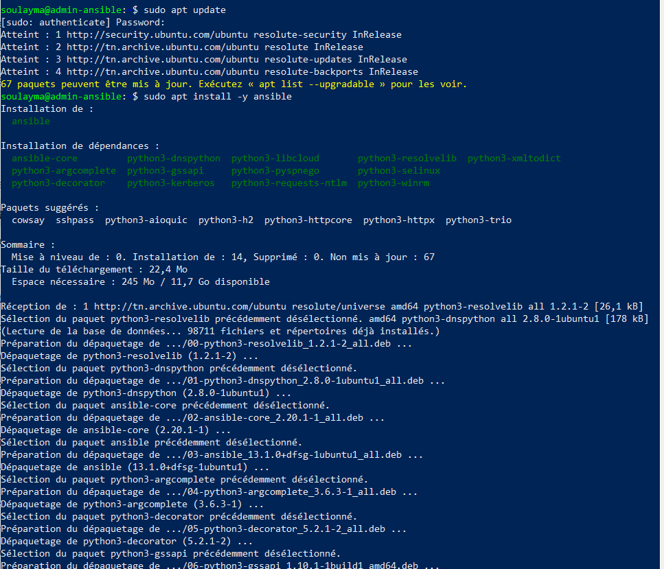

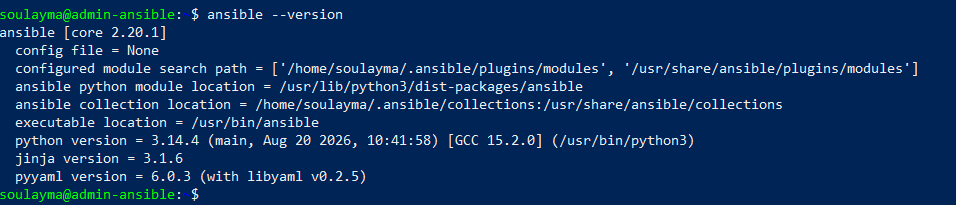

Connexion SSH sans mot de passe vers le serveur (clé ed25519) :

```bash
ssh-keygen -t ed25519
ssh-copy-id automatisation@192.168.190.141
ssh automatisation@192.168.190.141   # connexion sans mot de passe
```

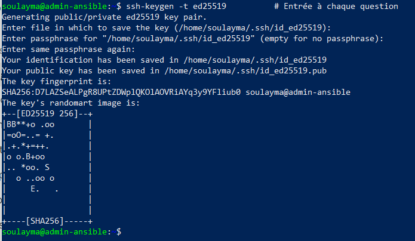

### 26. Inventory et test de communication

Création du dossier de travail :

```bash
mkdir -p ~/devsecops-portfolio/ansible && cd ~/devsecops-portfolio/ansible
```


`ansible/inventory.ini` :

```ini
[ubuntu_servers]
server1 ansible_host=192.168.190.141 ansible_user=automatisation

[docker_hosts]
server1

[all:vars]
ansible_python_interpreter=/usr/bin/python3
ansible_become_exe=/usr/bin/sudo.ws
```

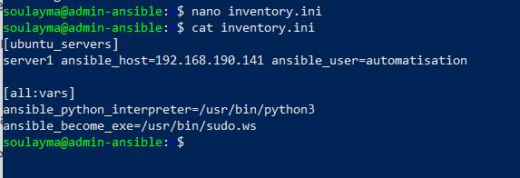

`ansible/ansible.cfg` (évite de répéter `-i inventory.ini`) :

```ini
[defaults]
inventory = inventory.ini
host_key_checking = False
```

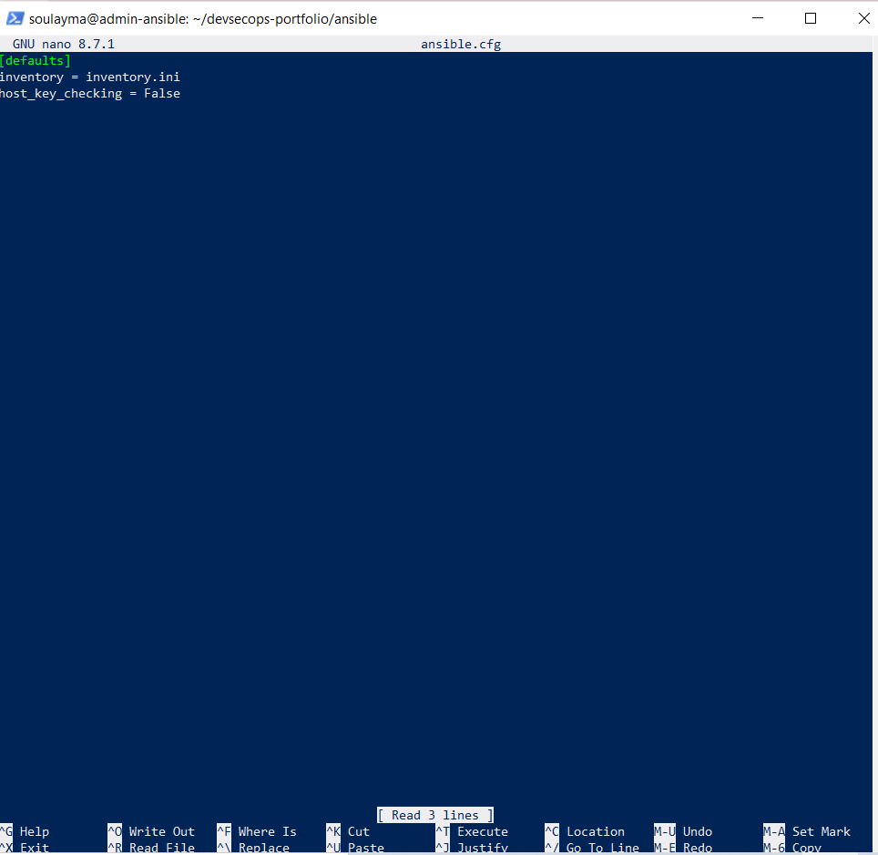

Commande :

```bash
ansible all -m ping
```


> **Problème rencontré** : Ubuntu 26.04 utilise `sudo-rs` par défaut, dont l'invite de mot de passe n'est pas reconnue par Ansible (`Timeout waiting for privilege escalation prompt`). Solution : utiliser le sudo classique, toujours présent sous le nom `/usr/bin/sudo.ws`, via `ansible_become_exe`.

### 27. Playbook : installation de paquets

`ansible/install_packages.yml` :

```yaml
---
- name: Installer des paquets de base
  hosts: ubuntu_servers
  become: true
  tasks:
    - name: Installer curl, git et tree
      ansible.builtin.apt:
        name:
          - curl
          - git
          - tree
        state: present
        update_cache: true
```

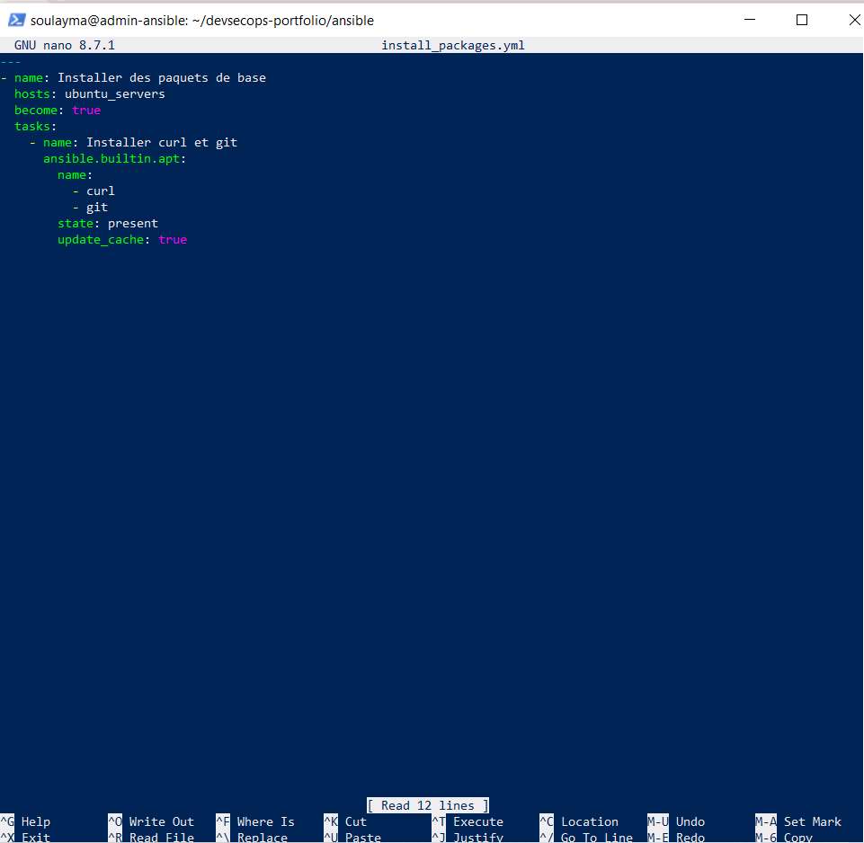

```bash
ansible-playbook install_packages.yml -K
```

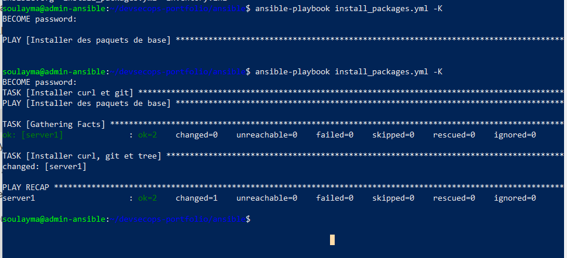

Une exécution sur des paquets déjà présents donne `changed=0` : Ansible est **idempotent**, il ne refait pas ce qui est déjà en place.

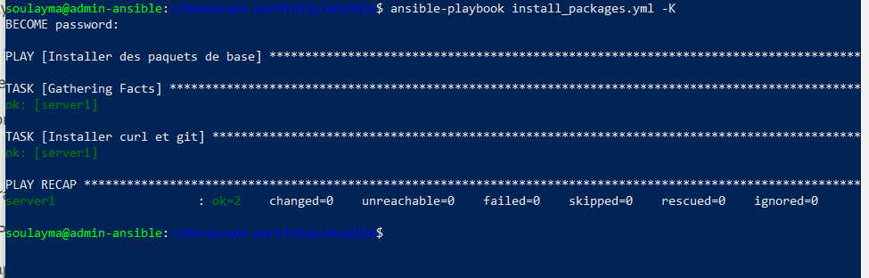

### 28. Playbook : installation de Docker

`ansible/install_docker.yml` :

```yaml
---
- name: Installer Docker sur Ubuntu
  hosts: docker_hosts
  become: true

  tasks:
    - name: Installer Docker, Docker Compose et Buildx
      ansible.builtin.apt:
        name:
          - docker.io
          - docker-compose-v2
          - docker-buildx
        state: present
        update_cache: true

    - name: Démarrer Docker et l'activer au démarrage
      ansible.builtin.service:
        name: docker
        state: started
        enabled: true

    - name: Ajouter l'utilisateur au groupe docker
      ansible.builtin.user:
        name: "{{ ansible_user }}"
        groups: docker
        append: true

    - name: Récupérer la version de Docker
      ansible.builtin.command: docker --version
      register: docker_version
      changed_when: false

    - name: Récupérer la version de Docker Compose
      ansible.builtin.command: docker compose version
      register: compose_version
      changed_when: false

    - name: Afficher les versions
      ansible.builtin.debug:
        msg:
          - "{{ docker_version.stdout }}"
          - "{{ compose_version.stdout }}"
```

```bash
ansible-playbook install_docker.yml -K
```

Résultat de `docker --version` :

```
Docker version 29.1.3, build 29.1.3-0ubuntu4.1
Docker Compose version 2.40.3+ds1-0ubuntu1
```

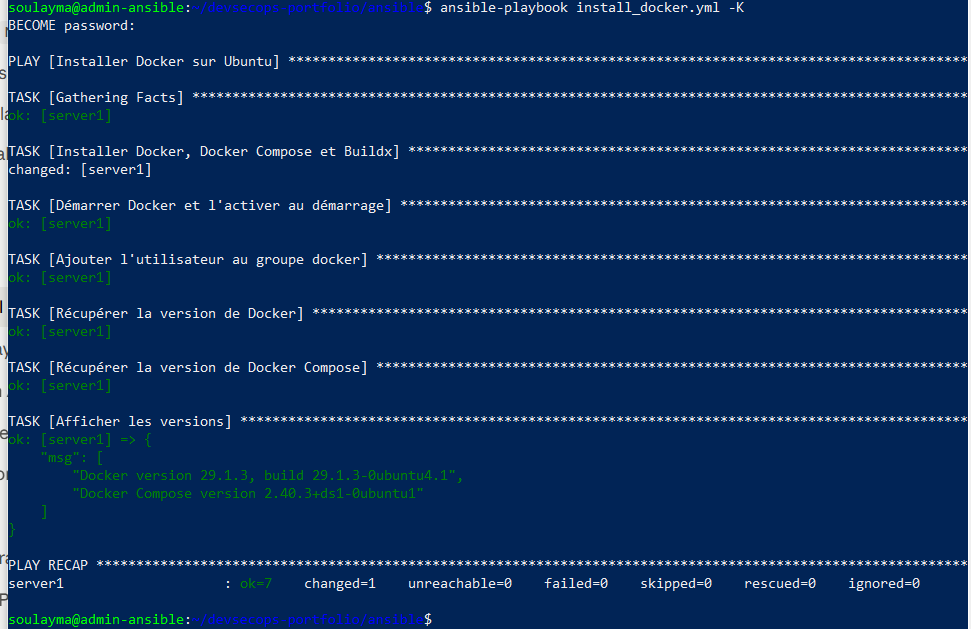

Les paquets Docker officiels d'Ubuntu (`docker.io`) sont utilisés pour éviter un conflit avec le `containerd` déjà présent. Le playbook est réutilisable sur toute nouvelle VM : il suffit de l'ajouter au groupe `docker_hosts`.

**Bonus** : `ansible/install_node.yml` installe Node.js 22 (npm est inclus dans le paquet `nodejs` d'Ubuntu 26.04, installer `npm` séparément provoque un conflit).

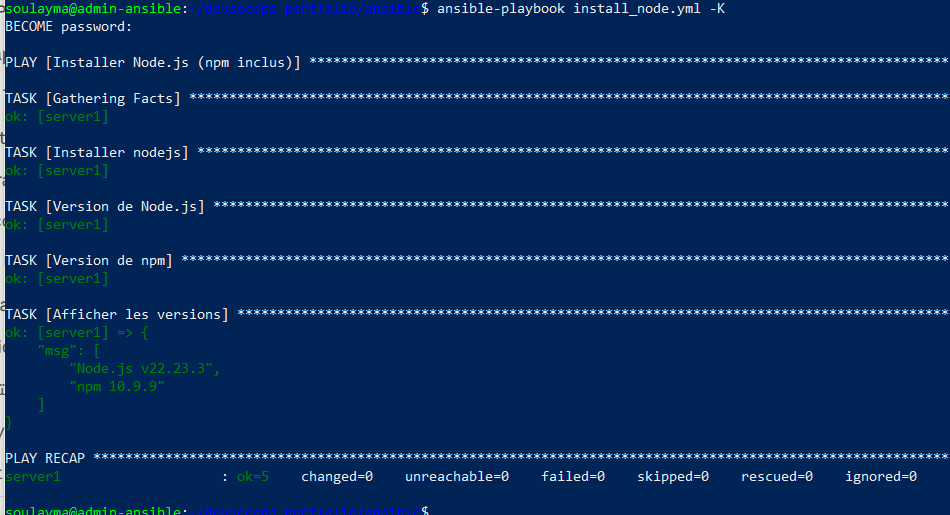

---

## VIII. API Node.js / Express

### 29. Structure de l'API

L'API est indépendante du frontend et se lance seule :

```bash
cd api
npm install
npm run dev
```

```
api/
├── Dockerfile
├── .dockerignore
├── .env.example
├── package.json
├── package-lock.json
└── src/
    ├── server.js          # serveur Express et routes
    └── data/
        └── portfolio.js   # profil, projets, compétences
```

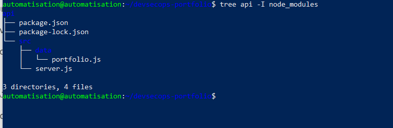

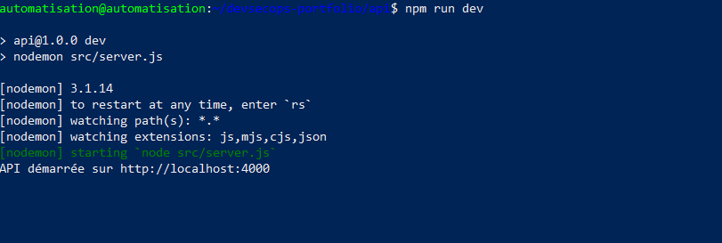

### 30. GET /api/health

```bash
curl http://192.168.190.141:4000/api/health
```

```json
{ "status": "ok", "message": "API opérationnelle", "uptime": 512.55, "timestamp": "2026-10-20T11:52:39.385Z" }
```

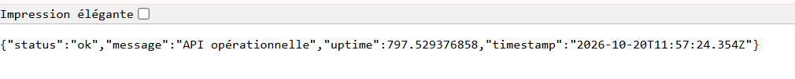

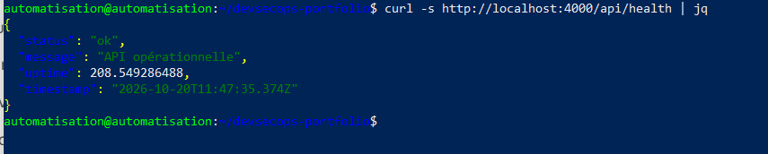

### 31. GET /api/profile

Retourne le nom, le titre, la présentation et les contacts du portfolio.


### 32. GET /api/projects

Retourne la liste des projets (`slug`, `name`, `summary`, `description`, `tech`). Une route `GET /api/projects/:slug` retourne aussi le détail d'un projet.


### 33. GET /api/skills


> **Problème rencontré** : l'API répondait en local mais pas depuis Windows (`ERR_CONNECTION_TIMED_OUT`). Le pare-feu UFW bloquait les ports. Solution : `sudo ufw allow 4000/tcp` et `sudo ufw allow 3000/tcp`.
>
> 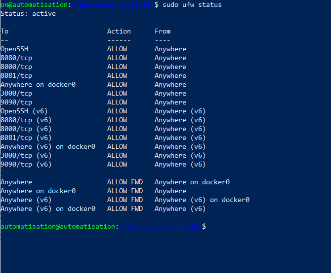

### 34. Projets récupérés depuis l'API

Les composants `About`, `Projects` et `Skills` ne lisent plus directement `data/` : ils appellent l'API côté serveur via `lib/api.js`.

```js
const API_URL = process.env.API_URL || "http://127.0.0.1:4000";

async function fetchFromApi(path, fallback) {
  try {
    const res = await fetch(`${API_URL}${path}`, { cache: "no-store" });
    if (!res.ok) throw new Error(`HTTP ${res.status}`);
    return { data: await res.json(), source: "api" };
  } catch (err) {
    return { data: fallback, source: "local" };   // repli sur data/
  }
}
```

- Un badge **« Données fournies par l'API Express »** indique la source des données.
- Si l'API est arrêtée, les données locales de `data/` sont affichées (badge rouge) : le site reste disponible.
- Les pages utilisent `export const dynamic = "force-dynamic"` : l'API est appelée à chaque requête et non figée au moment du build. Le build (et donc le pipeline Jenkins) fonctionne même sans API.
- Les projets « Automatisation avec Ansible » et « API Node.js / Express » n'existent que dans l'API : leur présence prouve que les données viennent bien de l'API.

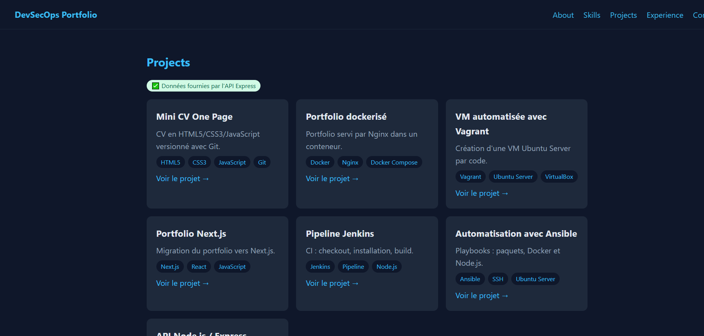

### 35. Compétences récupérées depuis l'API

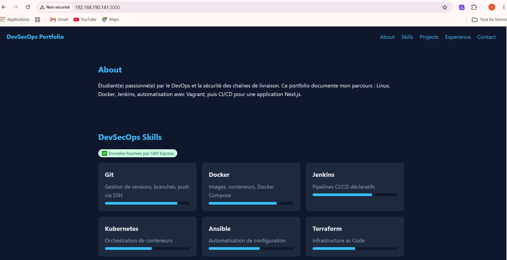

---

## IX. Variables d'environnement et configuration

### 36. API_URL

`.env.local` (non versionné) :

```
API_URL=http://127.0.0.1:4000
```

**Pourquoi ne pas coder l'URL en dur ?** L'adresse de l'API change selon l'environnement : `127.0.0.1:4000` en local, `http://api:4000` dans Docker Compose, un nom de domaine en production. Coder l'URL en dur obligerait à modifier le code et reconstruire l'image à chaque changement. Avec une variable d'environnement, la même image fonctionne partout et la configuration reste séparée du code. L'appel se faisant côté serveur, `API_URL` n'est jamais exposée au navigateur.

> `127.0.0.1` est utilisé plutôt que `localhost`, que Node.js 22 peut résoudre en IPv6 (`::1`).

### 37. .env.example

`.env.example` (versionné, sans secret) :

```
# URL de l'API Express, appelée côté serveur par Next.js
# Local          : http://127.0.0.1:4000
# Docker Compose : http://api:4000
API_URL=http://127.0.0.1:4000
```

`api/.env.example` :

```
PORT=4000
CORS_ORIGIN=http://localhost:3000
```

Le `.gitignore` contient `.env*` puis `!.env.example` : les vrais fichiers `.env` ne sont jamais poussés sur GitHub.

---

## X. Dockerisation frontend + API

### 38. Dockerfile du frontend

`next.config.mjs` contient `output: "standalone"`.

```dockerfile
# 1) Installation des dépendances
FROM node:22-alpine AS deps
WORKDIR /app
COPY package*.json ./
RUN npm ci --fetch-retries=5 --fetch-retry-mintimeout=20000 --fetch-retry-maxtimeout=120000 --fetch-timeout=600000

# 2) Build de l'application
FROM node:22-alpine AS builder
WORKDIR /app
COPY --from=deps /app/node_modules ./node_modules
COPY . .
ENV NEXT_TELEMETRY_DISABLED=1
RUN npm run build

# 3) Image finale minimale (mode standalone)
FROM node:22-alpine AS runner
WORKDIR /app
ENV NODE_ENV=production \
    NEXT_TELEMETRY_DISABLED=1 \
    PORT=3000 \
    HOSTNAME=0.0.0.0

RUN addgroup -S nextjs && adduser -S nextjs -G nextjs

COPY --from=builder /app/public ./public
COPY --from=builder --chown=nextjs:nextjs /app/.next/standalone ./
COPY --from=builder --chown=nextjs:nextjs /app/.next/static ./.next/static

USER nextjs
EXPOSE 3000
CMD ["node", "server.js"]
```

- **Build multi-étapes** : l'image finale contient seulement l'application compilée, sans code source ni dépendances de développement (image plus légère, surface d'attaque réduite).
- **Utilisateur non root** `nextjs` (bonne pratique DevSecOps).
- `.dockerignore` exclut `node_modules`, `.git`, `.env*`, `api/`, `ansible/` et `docs/`.
- Les options `--fetch-retries` rendent `npm ci` tolérant à une connexion lente.

### 39. Dockerfile de l'API

`api/Dockerfile` :

```dockerfile
FROM node:22-alpine
WORKDIR /app
ENV NODE_ENV=production

COPY package*.json ./
RUN npm ci --omit=dev

COPY src ./src

USER node
EXPOSE 4000
CMD ["node", "src/server.js"]
```

- `--omit=dev` : seules les dépendances de production sont installées (pas de nodemon).
- `package*.json` est copié avant le code pour profiter du cache Docker.
- Exécution avec l'utilisateur non root `node`.

### 40. Construction des images

```bash
docker build -t devsecops-api ./api
docker build --network=host -t devsecops-portfolio .
docker images | grep devsecops
```

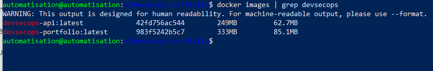

> **Problème rencontré** : `npm ci` restait bloqué (`ETIMEDOUT`) pendant le build, à cause du réseau de la VM (k3s y est aussi installé). Solution : build avec le réseau de l'hôte (`--network=host`, ou `network: host` dans le Compose).

### 41. Docker Compose

`docker-compose.yml` :

```yaml
services:
  api:
    build:
      context: ./api
      network: host
    image: devsecops-api
    container_name: devsecops-api
    environment:
      - PORT=4000
      - CORS_ORIGIN=http://localhost:3000
    ports:
      - "4000:4000"
    healthcheck:
      test: ["CMD", "wget", "-qO-", "http://127.0.0.1:4000/api/health"]
      interval: 10s
      timeout: 3s
      retries: 5
    networks:
      - portfolio-net
    restart: unless-stopped

  frontend:
    build:
      context: .
      network: host
    image: devsecops-portfolio
    container_name: devsecops-portfolio
    environment:
      - API_URL=http://api:4000
    ports:
      - "3000:3000"
    depends_on:
      api:
        condition: service_healthy
    networks:
      - portfolio-net
    restart: unless-stopped

networks:
  portfolio-net:
    driver: bridge
```

```bash
docker compose up -d
docker compose ps
```

```
NAME                  IMAGE                 SERVICE    STATUS                    PORTS
devsecops-api         devsecops-api         api        Up (healthy)              0.0.0.0:4000->4000/tcp
devsecops-portfolio   devsecops-portfolio   frontend   Up                        0.0.0.0:3000->3000/tcp
```

Le `healthcheck` vérifie `/api/health` ; grâce à `depends_on: condition: service_healthy`, le frontend ne démarre qu'une fois l'API prête.


### 42. Communication frontend ↔ API

Dans Compose, `API_URL=http://api:4000` : **`api` est le nom du service**, résolu par le DNS interne de Docker sur le réseau `portfolio-net`. Le frontend joint l'API sans connaître son adresse IP.

```bash
docker compose exec frontend wget -qO- http://api:4000/api/health
```

```json
{"status":"ok","message":"API opérationnelle","uptime":168.75,"timestamp":"2026-10-20T14:14:33.164Z"}
```

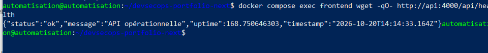


Démonstration du repli : `docker compose stop api` → le portfolio affiche les données locales ; `docker compose start api` → les données de l'API reviennent.

---

# Activité 4 : Vagrant/Ansible, sécurisation de l'API, PostgreSQL, tests et pipeline DevSecOps

## Avancement

| Partie | Questions | État |
|---|---|---|
| 11. Vagrant + Ansible | 43 | ✅ fait |
| | 44-45 | 🔄 en cours (captures `vagrant up` / `destroy` à ajouter) |
| 12. API sécurisée | 46-52 | ✅ fait |
| 13. PostgreSQL / Prisma | 53-56 | ✅ fait |
| 14. Tests | 57-60 | ✅ fait |
| 15. Jenkins tests + images | 61-63 | 🔄 stages tests OK, build/tag SHA à finaliser |
| 16. Pipeline DevSecOps | 64-69 | 🔄 en cours (Gitleaks OK, Semgrep/npm audit/Dependency-Check/Trivy à finaliser) |

---

## 11. Vagrant + Ansible

### Q43 : playbook de déploiement du Portfolio

```bash
cd ~/portfolio-iac
vagrant provision        # lance : ansible-playbook ansible/site.yml
```

Le playbook (`vagrant/ansible/site.yml`) utilise deux rôles : `docker_install` (Docker + plugin Compose) et `portfolio_deploy` (clone du dépôt, `docker compose up -d --build`, attente du port 3000, affichage de `docker ps`).

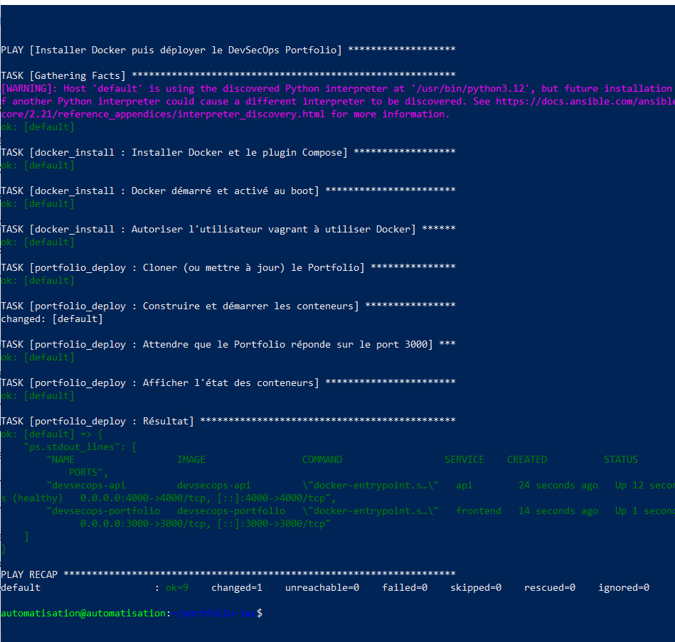
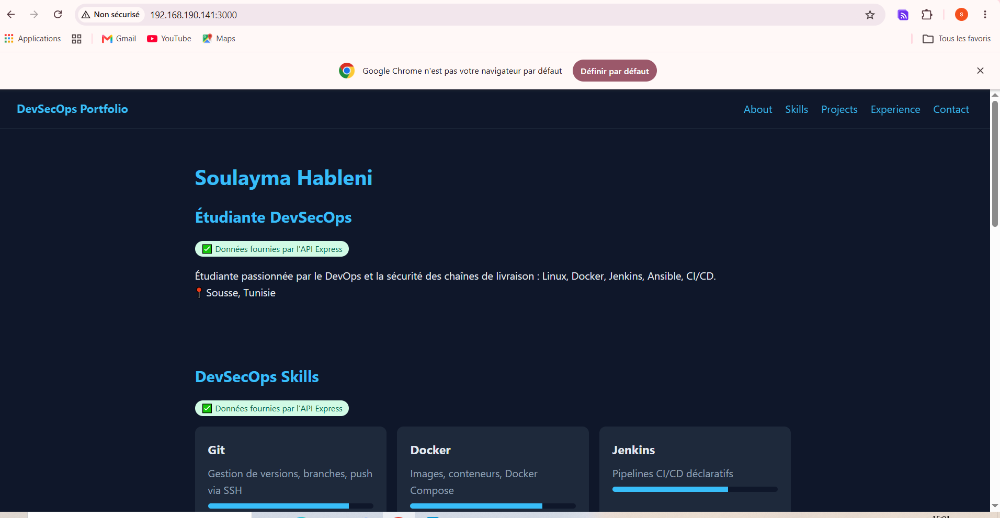

### Q44 : lancement automatique d'Ansible par Vagrant

`vagrant up` -> création de la VM -> provisioner `ansible_local` -> installation de Docker -> déploiement du Portfolio.

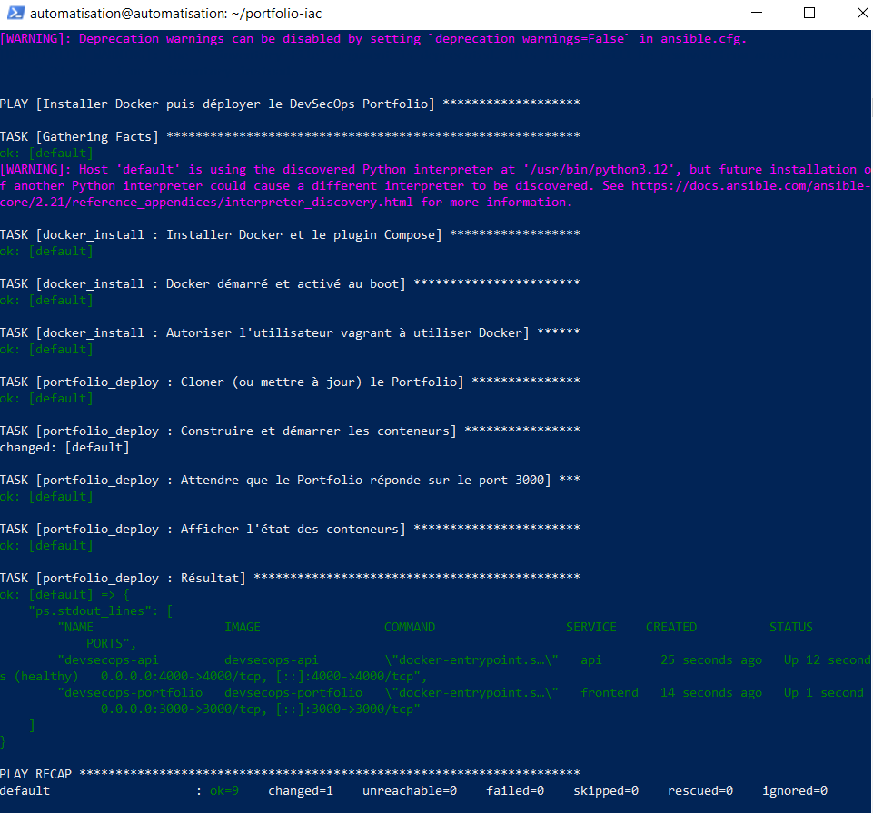

### Q45 : destroy puis up

```bash
vagrant destroy -f
vagrant up
```
> Capture à ajouter.

---

## 12. Évolution et sécurisation de l'API

### Q46 : route `POST /api/contact`

```bash
curl -i -X POST http://localhost:4000/api/contact \
  -H "Content-Type: application/json" \
  -d '{"name":"Soulayma","email":"test@example.com","message":"Bonjour, ceci est un test"}'
```
Réponse : `HTTP/1.1 201 Created` — `{"message":"Message reçu","id":1}`

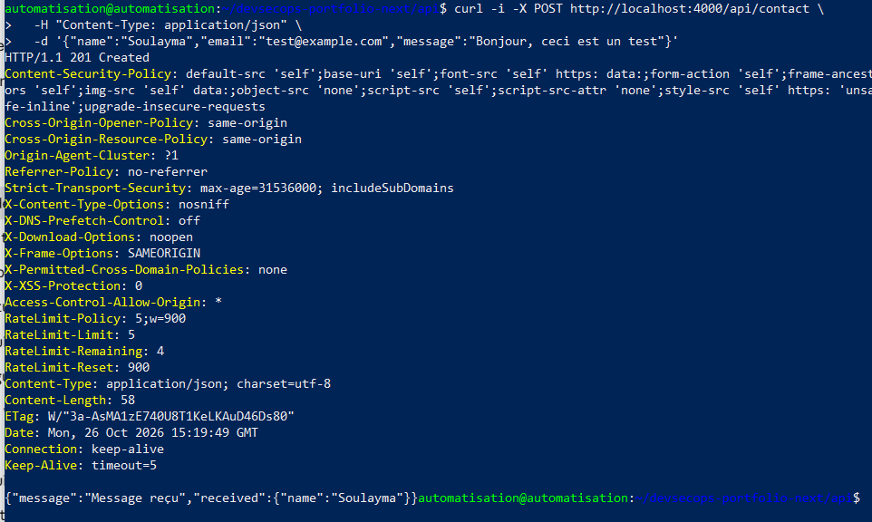

### Q47 : formulaire Next.js connecté à l'API

Le formulaire (`components/Contact.jsx`) appelle `app/api/contact/route.js`, qui relaie vers l'API Express (`API_URL`).

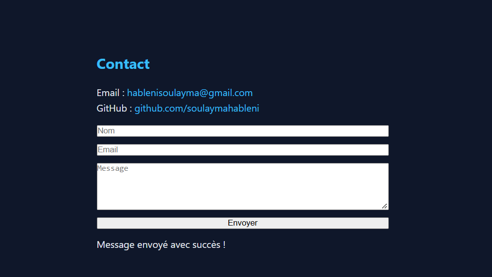

### Q48 : validation stricte avec Zod

Schéma `.strict()` : champs inconnus, email invalide ou message trop court -> `400`.

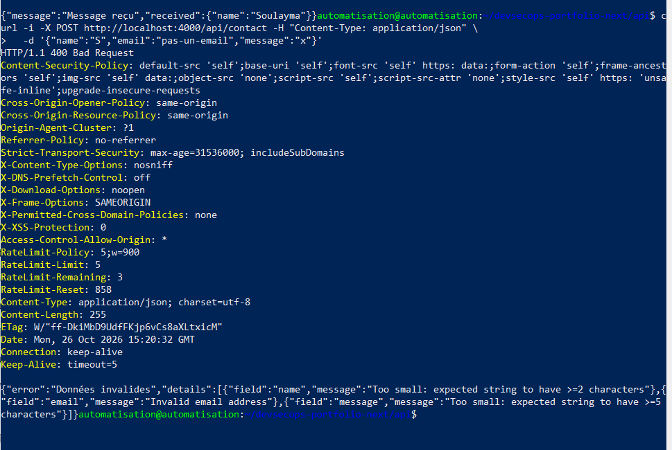

### Q49 : gestion centralisée des erreurs

Un seul middleware d'erreur renvoie un JSON propre, sans stack trace (ex. JSON malformé -> 400).

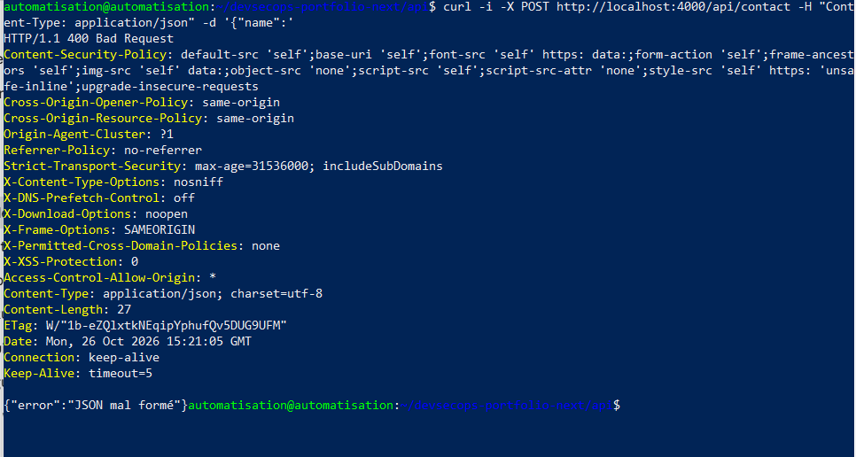

### Q50 : headers de sécurité Helmet

```bash
curl -I http://localhost:4000/api/health
```
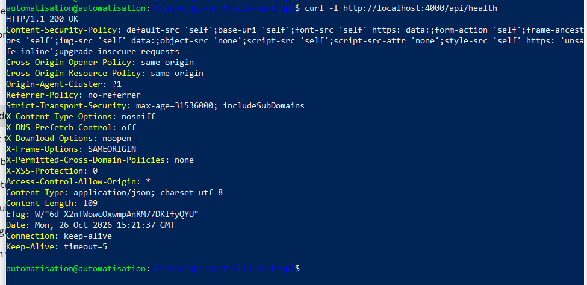

### Q51 : rate limiting (5 requêtes / 15 min sur `POST /api/contact`)

Les 5 premières requêtes passent (201), la 6e est refusée (429).

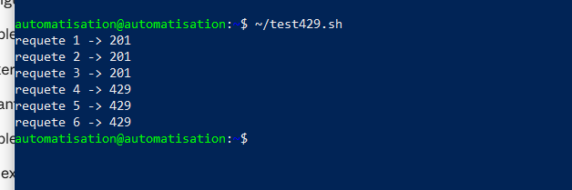
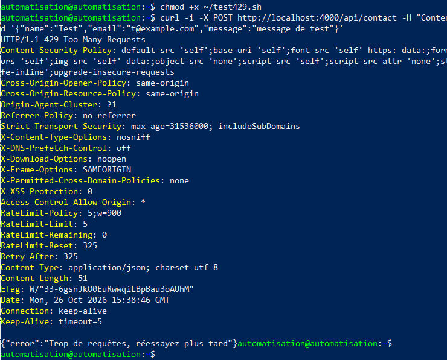

### Q52 : OWASP API Security Top 10

| Risque OWASP | Concerne notre API ? | Mesure en place / prévue |
|---|---|---|
| API1 Broken Object Level Authorization | Faible (pas de comptes utilisateurs) | Aucune ressource privée exposée ; à prévoir si authentification ajoutée |
| API2 Broken Authentication | Non (API publique en lecture) | Prévu : authentification pour toute future route d'administration |
| API3 Broken Object Property Level Authorization | Oui | Zod `.strict()` : seuls `name`, `email`, `message` sont acceptés |
| API4 Unrestricted Resource Consumption | Oui | Rate limiting 5/15 min sur `/api/contact` ; corps JSON limité à 10 kb |
| API5 Broken Function Level Authorization | Faible | Seules des routes GET publiques + un POST de contact |
| API6 Unrestricted Access to Sensitive Business Flows | Oui (spam du formulaire) | Rate limiting ; prévu : captcha |
| API7 Server Side Request Forgery | Non | L'API n'appelle aucune URL fournie par l'utilisateur |
| API8 Security Misconfiguration | Oui | Helmet, `x-powered-by` désactivé, CORS restreint (`CORS_ORIGIN`), erreurs sans stack trace, secrets en variables d'environnement |
| API9 Improper Inventory Management | Faible | Routes documentées dans ce README |
| API10 Unsafe Consumption of APIs | Non | Aucune API tierce consommée |

---

## 13. PostgreSQL et Prisma

### Q53 : service PostgreSQL dans Docker Compose

Service `db` : image `postgres:16-alpine`, healthcheck `pg_isready`, volume `pgdata`.

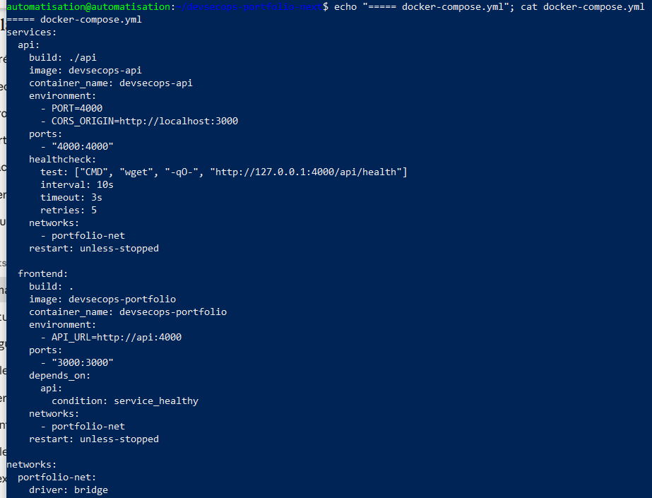
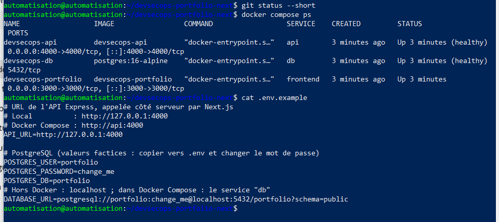

### Q54 : enregistrement des messages en base

```bash
docker compose exec db psql -U portfolio -d portfolio -c 'SELECT * FROM "Message";'
```
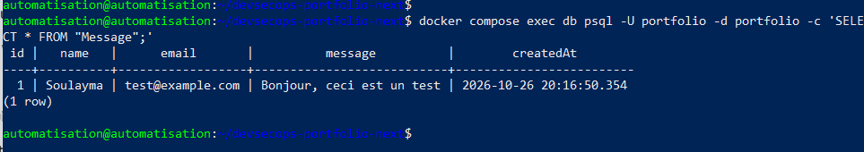
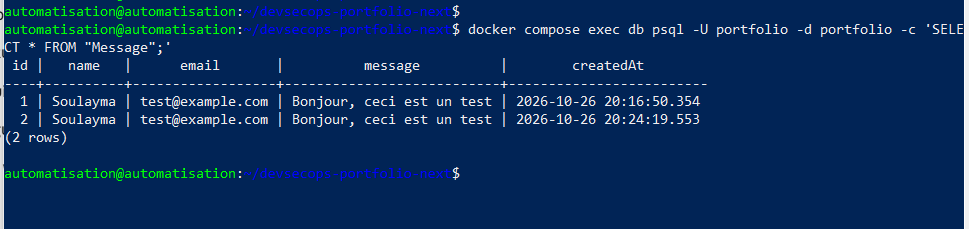

### Q55 : migrations Prisma

```bash
cd api
npx prisma migrate dev --name init     # développement
npx prisma migrate deploy              # production (lancé au démarrage du conteneur API)
```
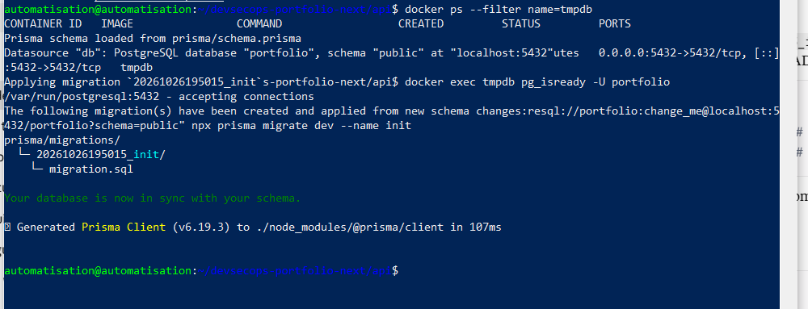

### Q56 : variables dans `.env.example`

`POSTGRES_USER`, `POSTGRES_PASSWORD`, `POSTGRES_DB`, `DATABASE_URL` (valeurs factices uniquement ; le vrai `.env` n'est pas versionné).

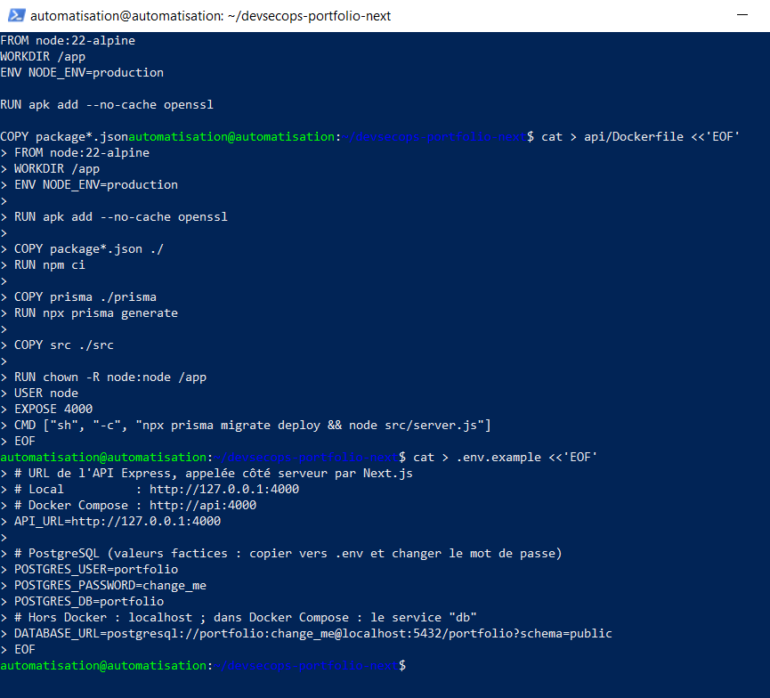

---

## 14. Tests applicatifs

### Q57 : test frontend (Vitest + Testing Library)

```bash
npm test
```
3 tests passés (`tests/Contact.test.jsx`).

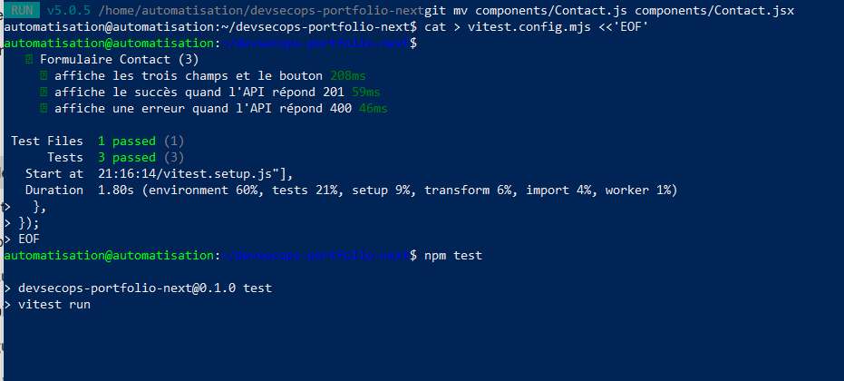

### Q58-59 : tests API (Jest + Supertest) : route, entrées invalides, injections, requêtes malformées

```bash
cd api && npm test
```
17 tests passés (`api.test.js`, `security.test.js`).

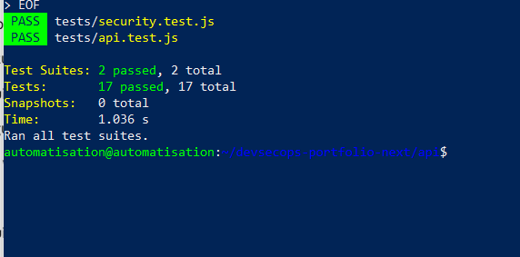

### Q60 : test d'intégration frontend -> API -> PostgreSQL

```bash
npm run test:integration     # bash tests/integration.sh
```
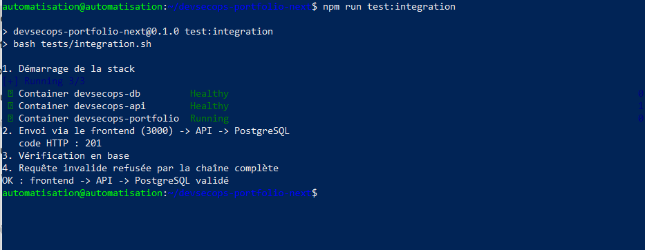

---

## 15-16. Jenkins et pipeline DevSecOps

Le `Jenkinsfile` enchaîne : Checkout + Git SHA, Tests API, Tests Frontend (conteneur `node:22-alpine`), Gitleaks, Semgrep, npm audit, Dependency-Check, build des images `devsecops-portfolio:<SHA>` et `devsecops-api:<SHA>`, Trivy (échec si CRITICAL).

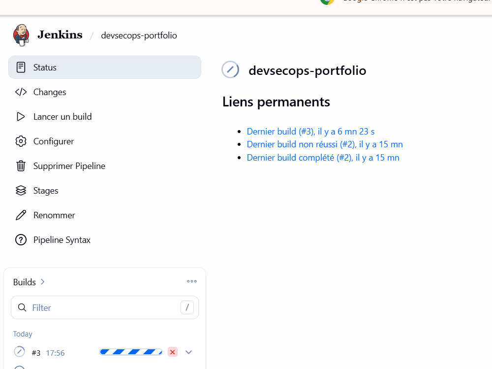

> Captures des stages complets, des images taguées par SHA (Q63), des scanners (Q64-68) et des pipelines réussi/échoué (Q69) : à compléter.
