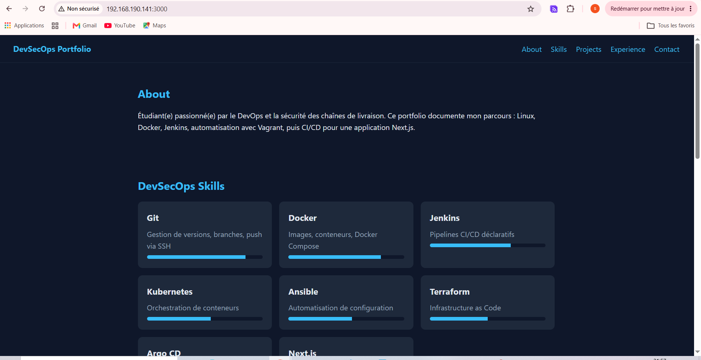
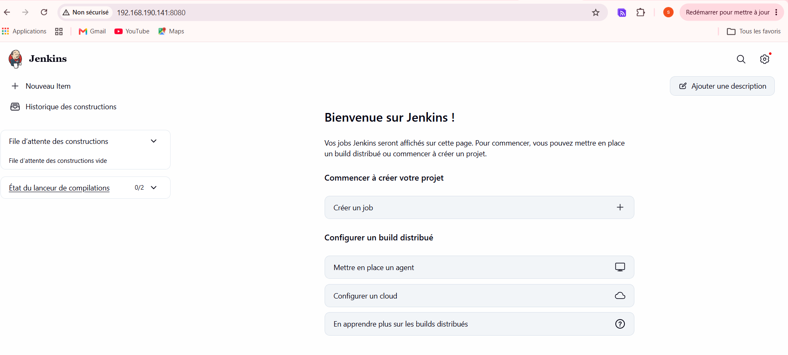
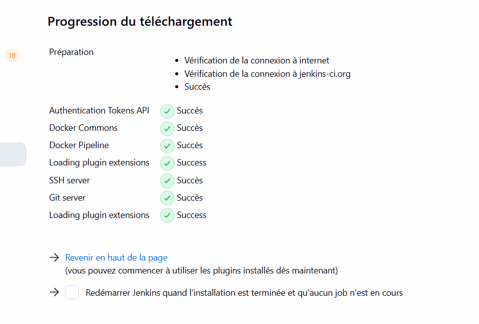
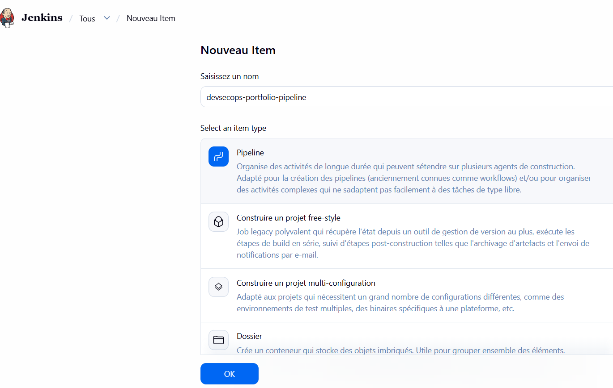
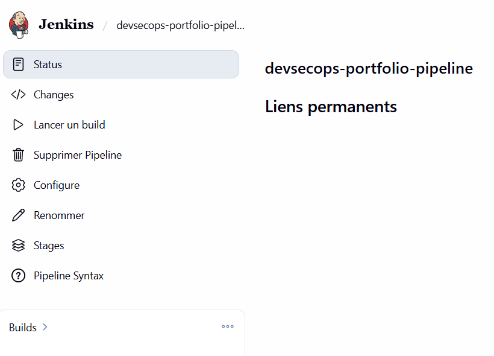
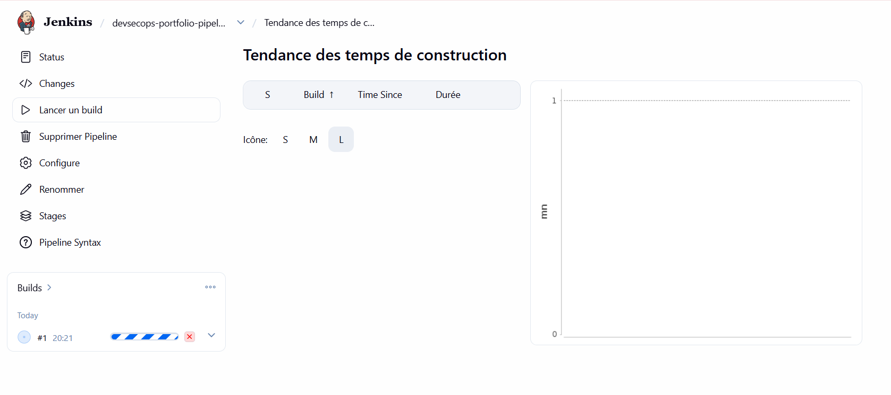
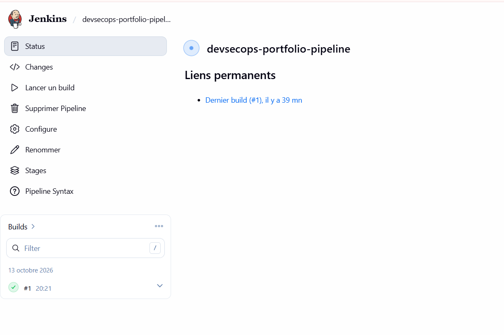

# DevSecOps Portfolio — Next.js + Jenkins

Suite du projet DevSecOps (parties 18 à 24).
Parties 1 à 17 (SSH, Docker, Jenkins, CV, Dockerisation, Vagrant) : https://github.com/soulaymahableni/mini-cv

**Environnement** : VM Ubuntu Server (VMware, IP `192.168.190.141`), Node.js 22, Next.js 16, Jenkins sur le port 8080.

---

## V. Migration du Portfolio vers Next.js

### 18. Création du projet

Installation de Node.js 22 sur la VM, puis création du projet :

```bash
sudo apt update && sudo apt install -y curl ca-certificates
curl -fsSL https://deb.nodesource.com/setup_22.x | sudo -E bash -
sudo apt install -y nodejs
node --version && npm --version && npx --version

npx create-next-app@latest devsecops-portfolio-next --js --eslint --no-tailwind --app --no-src-dir --import-alias "@/*" --use-npm
cd devsecops-portfolio-next
npm run dev -- -H 0.0.0.0
```

L'option `-H 0.0.0.0` rend le serveur accessible depuis la machine physique : `http://192.168.190.141:3000`.

Sections conservées : **About, Skills, Projects, Experience, Contact**.



### 19. Composants réutilisables

```text
devsecops-portfolio-next/
├── app/
│   ├── layout.js              # Header + Footer communs
│   ├── page.js                # Accueil : About, Skills, Projects, Experience, Contact
│   ├── globals.css
│   └── projects/
│       ├── page.js            # /projects
│       └── [slug]/page.js     # /projects/project-name
├── components/
│   ├── Header.js
│   ├── About.js
│   ├── Skills.js
│   ├── Projects.js
│   ├── Experience.js
│   ├── Contact.js
│   └── Footer.js
├── data/
│   ├── projects.js
│   └── skills.js
├── Jenkinsfile
└── next.config.mjs
```

### 20. Données séparées des composants

Les informations sont stockées dans `data/` et importées par les composants, qui génèrent l'affichage avec `.map()`.

`data/projects.js` :

```js
export const projects = [
  {
    slug: "portfolio-docker",
    name: "Portfolio dockerisé",
    summary: "Portfolio servi par Nginx dans un conteneur.",
    description: "Image Docker cv-docker basée sur Nginx, lancée avec docker run puis Docker Compose.",
    tech: ["Docker", "Nginx", "Docker Compose"],
  },
  // ...
];

export function getProject(slug) {
  return projects.find((p) => p.slug === slug);
}
```

`data/skills.js` :

```js
export const skills = [
  { name: "Docker", level: 80, description: "Images, conteneurs, Docker Compose" },
  { name: "Jenkins", level: 70, description: "Pipelines CI/CD déclaratifs" },
  // Git, Kubernetes, Ansible, Terraform, Argo CD, Next.js...
];
```

### 21. Pages dédiées aux projets

| Route | Fichier | Rôle |
|---|---|---|
| `/projects` | `app/projects/page.js` | Liste de tous les projets |
| `/projects/project-name` | `app/projects/[slug]/page.js` | Détail d'un projet (route dynamique) |

Exemples : `http://192.168.190.141:3000/projects` et `http://192.168.190.141:3000/projects/portfolio-nextjs`.

<!-- À AJOUTER : captures des deux pages -->


---

## VI. Premier pipeline Jenkins

### Préparation de Jenkins

Pour que le pipeline puisse utiliser un agent Docker :

```bash
sudo usermod -aG docker jenkins
sudo systemctl restart jenkins
```

Jenkins est accessible depuis la machine physique sur `http://192.168.190.141:8080`.



Plugins installés (Manage Jenkins → Plugins) : **Docker Pipeline**, **Docker Commons**, **Git server**, **SSH server**.



### 22. Pipeline : récupération du dépôt GitHub

Création du job : **Nouveau Item** → `devsecops-portfolio-pipeline` → type **Pipeline**.



Configuration du job : *Pipeline script from SCM* → Git → URL du dépôt GitHub → branche `*/main` → Script Path `Jenkinsfile`.



Lancement du build n°1 :



Résultat : build n°1 réussi (coche verte).



**Jenkinsfile** :

```groovy
pipeline {
    agent {
        docker {
            image 'node:22-alpine'
            args '-u root:root'
        }
    }

    environment {
        CI = 'true'
        NEXT_TELEMETRY_DISABLED = '1'
    }

    stages {
        stage('Checkout') {
            steps {
                git branch: 'main',
                    url: 'https://github.com/soulaymahableni/devsecops-portfolio-next.git'
            }
        }

        stage('Install dependencies') {
            steps {
                sh 'node --version && npm --version'
                sh 'npm ci || npm install'
            }
        }

        stage('Build') {
            steps {
                sh 'npm run build'
            }
        }
    }

    post {
        success { echo 'Build Next.js réussi.' }
        failure { echo 'Le pipeline a échoué, consultez les logs.' }
    }
}
```

### 23. Installation des dépendances

Stage `Install dependencies` : `npm ci` installe les versions exactes du `package-lock.json` (reproductible) ; `npm install` sert de repli si le fichier de verrouillage est absent.

<!-- À AJOUTER : Console Output du stage -->


### 24. Build automatique

Stage `Build` : `npm run build` compile l'application Next.js (`Compiled successfully` dans les logs).

<!-- À AJOUTER : Console Output du stage -->


---

## Publication sur GitHub (SSH)

```bash
git branch -M main
git add .
git commit -m "Portfolio Next.js avec Jenkinsfile"
git remote add origin git@github.com:soulaymahableni/devsecops-portfolio-next.git
git push -u origin main
```

Dépôt : https://github.com/soulaymahableni/devsecops-portfolio-next
